# 원격 팀 프로젝트 관리 웹앱 — 설계 문서

> 대상: 2~10명 규모의 소규모 원격 팀
> 스택: React(Vite) · Node.js + Express · **Supabase(관리형 PostgreSQL)** · Socket.io · JWT
> 배포: **Vercel(프론트 + Express 함수, 단일 프로젝트·동일 오리진) + Supabase**, Socket.io 다중 인스턴스용 Redis(Vercel Marketplace)
> 상태: 구현 완료(M0~M9). 구현 중 확정한 규칙은 각 절의 "구현 규칙" 인용문에 적었다. 보안 점검 결과는 [SECURITY.md](SECURITY.md), 배포·운영은 [DEPLOYMENT.md](DEPLOYMENT.md).

---

## 0. 설계 원칙 및 주요 결정

| 결정 | 선택 | 이유 |
|---|---|---|
| 권한 모델 | **시스템 역할(users.role)** 하나 + 프로젝트 멤버십 | 팀이 작아 단순함이 우선. Admin=전체, **프로젝트를 만든 사람=그 프로젝트의 소유자(관리자)**, Member/Manager=소속 프로젝트 내 작업. 공개 가입을 열어 두므로 누구나 프로젝트를 만들 수 있다 |
| 프로젝트 접근 | `project_members` 에 속한 사용자만 접근 (Admin 제외) | 프로젝트별 가시성 제어 |
| 칸반 순서 | `position` (double precision, 사이에 끼우는 방식) | 드래그 시 한 행만 UPDATE. 정밀도 고갈 시 재정렬 |
| 상태 | Enum: `todo`, `in_progress`, `review`, `done` | 칸반 컬럼 고정으로 시작 (커스텀 컬럼은 향후 확장) |
| 인증 | Access JWT(15분, 메모리) + Refresh JWT(7일, httpOnly 쿠키, DB에 해시 저장) | XSS로부터 refresh 보호, 로그아웃/폐기 가능 |
| 실시간 | REST로 변경 → 서버가 Socket.io `project:{id}` 룸에 브로드캐스트 | 단일 쓰기 경로(REST)로 일관성 유지, 소켓은 푸시 전용 |
| 마감 임박 알림 | **Vercel Cron** 이 `/api/cron/*` 를 **하루 1회** 호출해 스캔 (마감일이 오늘·내일인 미완료 작업) | Vercel 함수는 상시 프로세스가 아니라 in-process node-cron 사용 불가. **Hobby 플랜은 Cron이 일 1회만 가능**(매시간 표현식은 배포 실패, 실행 시각 ±59분). 매시간 스캔은 Pro 필요. 엔드포인트는 `CRON_SECRET` 으로 보호. 중복 방지 컬럼 사용 |
| 동시 편집 충돌 | 마지막 쓰기 우선 + `updated_at` 기반 낙관적 체크(선택) | 단순화 |
| DB 호스팅 | **Supabase Postgres** (순수 Postgres로만 사용) | Express 서버가 `pg`로 직접 연결. Supabase Auth/Realtime/PostgREST는 쓰지 않음 → 스택(자체 JWT, Socket.io) 유지 |
| DB 접속 | **Transaction pooler(6543)**, `DATABASE_URL`, `pg` prepared statement 비활성 | Vercel 함수는 인스턴스가 늘고 줄어 연결 수가 불안정하므로 풀러 경유. 풀 크기는 작게(함수 인스턴스당 소수) 설정 |
| RLS | 모든 테이블 `ENABLE ROW LEVEL SECURITY`, 정책 없음 | Supabase는 `public` 스키마를 anon key로 PostgREST에 노출함. RLS를 켜고 정책을 두지 않으면 anon/authenticated 직접 접근이 차단되고, 서버(postgres 역할)는 RLS를 우회해 정상 동작 |
| 서버 수평 확장 | **Socket.io Redis adapter 필수** (Vercel Marketplace Redis) | Vercel은 인스턴스를 임의로 늘리고, 소켓 연결은 한 인스턴스에 고정됨. REST 처리 인스턴스와 소켓 보유 인스턴스가 달라도 브로드캐스트가 닿으려면 Redis 경유 필요. 방/접속자 상태를 메모리에 두지 않음 |
| 소켓 연결 | 클라이언트 `transports: ['websocket']`, 재연결 시 refetch | Socket.io 기본 long-polling은 Vercel에서 동작하지 않음. 함수 최대 실행시간(Hobby 300초)에 연결이 끊기므로 재연결이 정상 흐름 |

### 역할별 권한 매트릭스

| 동작 | Admin | Manager | Member |
|---|:-:|:-:|:-:|
| 사용자 역할 변경/비활성화 | ✅ | ❌ | ❌ |
| 프로젝트 생성 | ✅ | ✅ | ✅ (사용자당 최대 20개, Admin 제외) |
| 프로젝트 수정/삭제/멤버 관리 | ✅ | ✅(본인 소유) | ✅(본인 소유) |
| 작업 생성/수정/삭제 | ✅ | ✅ | 생성·수정 ✅ / 삭제는 본인 생성분만(프로젝트 소유자는 모두) |
| 작업 상태 이동 (칸반) | ✅ | ✅ | ✅ (소속 프로젝트) |
| 댓글 작성 | ✅ | ✅ | ✅ |
| 댓글 수정/삭제 | 수정은 작성자만 / 삭제는 모두 | 삭제는 소속 프로젝트 모두 | 본인 것만(프로젝트 소유자는 삭제 가능) |
| 대시보드 조회 | 전체 | 소속 프로젝트 | 소속 프로젝트 |

> 회원가입: 첫 가입자는 자동 Admin. 이후 가입자는 Member. 가입은 **누구에게나 열려 있고**(`ALLOW_REGISTRATION=false` 로 닫을 수 있음), 가입자는 자기 프로젝트를 만들고 이메일로 팀원을 초대해 쓴다. 사용자 목록은 공개하지 않는다(Admin/Manager 만). Admin이 역할 승격.
>
> 사용량 상한(공개 가입 + 무료 DB 용량 보호, 초과 시 409 `LIMIT_REACHED`, 환경변수로 조정): 사용자당 프로젝트 20개(`MAX_PROJECTS_PER_USER`, Admin 제외), 프로젝트당 멤버 50명(`MAX_MEMBERS_PER_PROJECT`), 프로젝트당 작업 1000개(`MAX_TASKS_PER_PROJECT`). 동시 요청에서는 상한을 한두 건 넘을 수 있다(엄격한 잠금은 두지 않음).

---

## 1. ERD

### 1.1 다이어그램

```mermaid
erDiagram
    users ||--o{ refresh_tokens : has
    users ||--o{ projects : owns
    users ||--o{ project_members : joins
    projects ||--o{ project_members : has
    projects ||--o{ tasks : contains
    users ||--o{ tasks : "assigned / created"
    tasks ||--o{ comments : has
    users ||--o{ comments : writes
    users ||--o{ notifications : receives
    tasks ||--o{ notifications : "refers to"
    tasks ||--o{ activity_logs : logs
    projects ||--o{ activity_logs : logs
    projects ||--o{ chat_messages : has
    users ||--o{ chat_messages : writes
    chat_messages ||--o{ chat_message_mentions : mentions
    users ||--o{ chat_message_mentions : "is mentioned"
    projects ||--o{ polls : has
    polls ||--o{ poll_options : offers
    poll_options ||--o{ poll_votes : receives
    users ||--o{ poll_votes : casts
    tasks ||--o{ checklist_items : has
    projects ||--o{ labels : defines
    tasks ||--o{ task_labels : tagged
    labels ||--o{ task_labels : applied
    projects ||--o{ saved_filters : has
    projects ||--o| github_connections : links
    tasks ||--o{ github_task_links : "linked PR/commit"
    users ||--o{ saved_filters : saves
    tasks ||--o{ task_dependencies : "is blocked by"
    comments ||--o{ comment_reactions : receives
    chat_messages ||--o{ chat_message_reactions : receives
    users ||--o{ comment_reactions : reacts
    users ||--o{ chat_message_reactions : reacts

    users {
        uuid id PK
        varchar email UK
        varchar password_hash
        varchar name
        enum role "admin|manager|member"
        boolean is_active
        jsonb preferences "개인 설정(M22), 허용 키만"
        timestamptz created_at
        timestamptz updated_at
    }
    refresh_tokens {
        uuid id PK
        uuid user_id FK
        varchar token_hash UK
        timestamptz expires_at
        timestamptz revoked_at
        timestamptz created_at
    }
    projects {
        uuid id PK
        varchar name
        text description
        uuid owner_id FK
        enum status "active|archived"
        timestamptz created_at
        timestamptz updated_at
    }
    project_members {
        uuid project_id PK,FK
        uuid user_id PK,FK
        timestamptz joined_at
    }
    tasks {
        uuid id PK
        uuid project_id FK
        varchar title
        text description
        enum status "todo|in_progress|review|done"
        enum priority "low|medium|high|urgent"
        uuid assignee_id FK "nullable"
        uuid created_by FK
        date due_date "nullable"
        double position
        timestamptz completed_at "nullable"
        timestamptz due_notified_at "nullable"
        timestamptz created_at
        timestamptz updated_at
    }
    comments {
        uuid id PK
        uuid task_id FK
        uuid author_id FK
        uuid parent_id FK "nullable, 답글이면 원 댓글(같은 작업, 한 단계만)"
        text body
        timestamptz created_at
        timestamptz updated_at
        timestamptz deleted_at "soft delete"
    }
    comment_mentions {
        uuid comment_id PK_FK
        uuid user_id PK_FK
        varchar name "멘션 시점의 이름(본문의 @이름 과 대응)"
        timestamptz created_at
    }
    notifications {
        uuid id PK
        uuid user_id FK
        enum type "task_assigned|due_soon|comment_added|task_overdue|mention"
        uuid task_id FK "nullable(채팅 멘션 알림은 NULL)"
        uuid project_id FK "nullable, 채팅 멘션 알림에만 채움(작업 알림은 작업에서 구함)"
        uuid actor_id FK "nullable"
        text message
        boolean is_read
        timestamptz created_at
    }
    share_links {
        uuid id PK
        uuid project_id FK
        uuid created_by FK "nullable"
        varchar token_hash UK "SHA-256, 원문 미저장"
        timestamptz expires_at
        timestamptz revoked_at "nullable"
        int view_count
        timestamptz last_viewed_at "nullable"
        timestamptz created_at
    }
    activity_logs {
        uuid id PK
        bigint seq "순번(커서 페이지네이션용)"
        uuid project_id FK
        uuid task_id "nullable, FK 없음(작업이 지워져도 기록 유지)"
        uuid actor_id FK "nullable, 탈퇴/삭제 시 NULL"
        varchar action "task.created|task.moved|..."
        jsonb meta
        timestamptz created_at
    }
    polls {
        uuid id PK
        uuid project_id FK
        uuid created_by FK "nullable, 탈퇴/삭제 시 NULL"
        varchar question "1~200자"
        boolean multiple "복수 선택 허용"
        timestamptz closed_at "nullable, 마감되면 값"
        timestamptz created_at
    }
    poll_options {
        uuid id PK
        uuid poll_id FK
        varchar label "1~100자"
        smallint position
    }
    poll_votes {
        uuid poll_id PK
        uuid option_id PK
        uuid user_id PK
        timestamptz created_at
    }
    checklist_items {
        uuid id PK
        uuid task_id FK
        varchar content "1~200자"
        boolean is_done
        double position "사이에 끼우는 방식"
        timestamptz created_at
    }
    labels {
        uuid id PK
        uuid project_id FK
        varchar name "1~30자, 프로젝트 안에서 대소문자 무시 유일"
        varchar color "팔레트 키(red·orange·yellow·green·blue·purple·pink·gray)"
        uuid created_by FK "nullable"
        timestamptz created_at
    }
    comment_reactions {
        uuid comment_id PK
        uuid user_id PK
        varchar emoji PK "허용 키 8종(CHECK)"
        timestamptz created_at
    }
    chat_message_reactions {
        uuid message_id PK
        uuid user_id PK
        varchar emoji PK "허용 키 8종(CHECK)"
        timestamptz created_at
    }
    task_dependencies {
        uuid task_id PK "이 작업은"
        uuid depends_on_id PK "이 선행 작업이 끝나야 시작할 수 있다"
        uuid project_id FK "두 작업이 같은 프로젝트임을 DB 가 보장"
        timestamptz created_at
    }
    github_connections {
        uuid id PK
        uuid project_id FK "UNIQUE, 프로젝트당 1개"
        varchar repo "owner/repo, 대소문자 무시 유일"
        int secret_version "웹훅 비밀 = HMAC(서버 비밀, id+version)"
        boolean move_on_open
        boolean done_on_merge
        timestamptz last_event_at
    }
    github_task_links {
        uuid id PK
        uuid task_id FK
        uuid project_id FK
        varchar kind "pull_request|commit"
        varchar external_id "PR 번호 또는 커밋 sha"
        varchar title
        varchar url
        varchar state "open|draft|merged|closed (PR 만)"
    }
    saved_filters {
        uuid id PK
        uuid project_id FK
        uuid user_id FK "본인만 보고 지운다"
        varchar name "1~40자, (프로젝트, 사용자) 안에서 대소문자 무시 유일"
        jsonb filters "status·priority·assignee·label·q 만 허용"
        timestamptz created_at
    }
    task_labels {
        uuid task_id PK
        uuid label_id PK
        uuid project_id FK "작업·라벨이 같은 프로젝트임을 DB 가 보장"
    }
    chat_message_mentions {
        uuid message_id PK
        uuid user_id PK
        varchar name "멘션 시점의 이름(본문의 @이름 과 대응)"
        timestamptz created_at
    }
    chat_messages {
        uuid id PK
        bigint seq "순번(커서 페이지네이션용)"
        uuid project_id FK
        uuid author_id FK "nullable, 탈퇴/삭제 시 NULL"
        text body "1~2000자"
        timestamptz created_at
    }
```



### 1.2 테이블 상세 / 제약 / 인덱스

**users**
- `email` UNIQUE (lower-case 저장), `password_hash` = bcrypt(cost 12)
- 비활성 사용자는 로그인 불가, 기존 작업의 `assignee_id` 는 유지

**refresh_tokens**
- 토큰 원문 대신 SHA-256 해시 저장. 회전(rotation): 재발급 시 기존 토큰 `revoked_at` 설정
- 인덱스: `(user_id)`, `(expires_at)`

**projects**
- `owner_id` → users, ON DELETE RESTRICT
- 삭제는 기본 archive 처리, 하드 삭제는 Admin만(CASCADE로 tasks/comments 삭제)

**project_members**
- PK `(project_id, user_id)`, 양쪽 FK ON DELETE CASCADE
- 인덱스: `(user_id)` — "내 프로젝트" 조회용
- 제약: 작업 담당자는 반드시 해당 프로젝트 멤버여야 함 → **애플리케이션 레벨 검증** (복합 FK로도 가능하나 단순화)

**tasks**
- 인덱스:
  - `(project_id, status, position)` — 칸반 보드 조회/정렬
  - `(assignee_id, status)` — 내 작업 조회
  - `(due_date) WHERE status <> 'done'` — 마감 스캔 (partial index)
- `status` 가 `done` 으로 바뀌면 `completed_at = now()`, 다른 상태로 되돌리면 NULL
- `due_notified_at` — 임박 알림 중복 방지. `due_date` 변경 시 NULL로 리셋
- CHECK: `title` 길이 1~200

**comments**
- 인덱스: `(task_id, created_at)`
- 삭제는 soft delete (`deleted_at`), 본문은 응답 시 "삭제된 댓글"로 마스킹

**comment_mentions** (M11 멘션)
- 댓글이 누구를 멘션했는지 **명시적으로** 저장한다(본문 문자열을 해석해 추측하지 않는다). PK `(comment_id, user_id)`, 둘 다 `ON DELETE CASCADE`.
- `name` 은 멘션한 시점의 이름이다. 본문의 `@이름` 텍스트와 짝이 되어, 나중에 이름이 바뀌어도 화면에서 강조 표시가 어긋나지 않는다.
- 인덱스: `(user_id, created_at DESC)` — "나를 멘션한 글" 모아보기(M14)용.

**notifications**
- 마이그레이션 013: 채팅 멘션 알림은 작업이 없으므로 `task_id` 를 NULL 허용으로 바꾸고 `project_id`(`ON DELETE CASCADE`, NULL 허용)를 더한다. 작업 알림은 이전처럼 `task_id` 로 작업을 거쳐 프로젝트를 구하고(`COALESCE(tasks.project_id, notifications.project_id)`), 채팅 멘션 알림만 `project_id` 를 직접 채운다.
- 인덱스: `(user_id, is_read, created_at DESC)`
- 보관: 90일 이후 정리(cron)

**activity_logs** (M10 활동 기록)
- 프로젝트에서 일어난 변경의 시간순 기록. 팀원이 모두 보는 타임라인과 작업별 변경 이력의 기반이다.
- `project_id` 는 `ON DELETE CASCADE`, `actor_id` 는 `ON DELETE SET NULL`(사용자가 지워져도 기록 유지, 화면에는 "알 수 없는 사용자"). `task_id` 는 FK 를 걸지 않는다(작업이 삭제돼도 "작업 삭제" 기록과 이전 기록이 남아야 한다).
- `seq` = `bigint GENERATED ALWAYS AS IDENTITY`. 커서 페이지네이션(`seq < 마지막 seq`, 내림차순)에 쓴다 — `created_at` 은 마이크로초라 JS 로 왕복하면 어긋난다.
- 인덱스: `(project_id, seq DESC)`, `(task_id, seq DESC) WHERE task_id IS NOT NULL`
- 이름·제목은 **그 시점의 값을 meta 에 복사**해 둔다(이름이 바뀌거나 멤버가 제거돼도 기록이 읽힌다). 댓글 **본문은 저장하지 않는다**(수정·삭제된 내용이 기록에 남지 않게).
- 기록하는 action 과 meta:
  - `project.created` `{name}`, `project.updated` `{changes: {name?, status?}}`(각 `{from,to}`)
  - `member.added` / `member.removed` `{user: {id, name}}`
  - `task.created` `{title, status, assignee?: {id, name}}`
  - `task.updated` `{title, changes: {title?, status?, priority?, dueDate?, assignee?, description?: true}}`(각 `{from,to}`, 담당자는 `{id,name}|null`, 설명은 내용 대신 변경 사실만)
  - `task.moved` `{title, from, to}` — **상태(컬럼)가 바뀐 이동만** 기록. 같은 컬럼 안의 순서 변경은 노이즈라 기록하지 않는다.
  - `task.deleted` `{title}`
  - `comment.created` / `comment.deleted` `{taskTitle}`(댓글 수정은 기록하지 않음)
  - `share.created` `{expiresAt}` / `share.revoked` `{}` (히스토리 공유 링크, M10b)
- 기록은 요청의 본 동작이 성공한 뒤에 별도로 저장한다(같은 트랜잭션이 아님). 기록 저장이 실패해도 요청은 실패시키지 않고 로그만 남긴다 → 드물게 기록이 빠질 수 있다.
- 보관: 180일 이후 정리(cron, 알림 정리와 같은 일일 작업)

**polls / poll_options / poll_votes** (M15 투표, 마이그레이션 012)
- 프로젝트 안 투표. `polls.project_id` `ON DELETE CASCADE`, `created_by` `ON DELETE SET NULL`. 선택지는 `poll_options`(투표당 2~10개, 순서 `position`), 표는 `poll_votes`.
- `poll_votes` 의 기본키는 `(poll_id, option_id, user_id)` 이고, `(poll_id, option_id)` → `poll_options(poll_id, id)` 복합 외래키 + `ON DELETE CASCADE` 로 **다른 투표의 선택지에 표를 던질 수 없게** DB 가 보장한다. 사용자가 지워지면 표도 사라진다.
- **1인 1표(단일 선택)** 는 서버가 보장한다: 투표 행을 `SELECT … FOR UPDATE` 로 잠근 트랜잭션 안에서 "내 표 전부 삭제 → 새 표 삽입"을 하므로 동시에 두 번 눌러도 한 표만 남는다. 복수 선택 투표(`multiple`)는 선택지마다 한 표씩이다.
- 집계는 **지금 프로젝트 멤버인 사용자의 표만** 센다(`project_members` 조인). 멤버에서 제거되면 그 사람의 표는 결과에서 빠진다(행은 남아 다시 추가되면 되살아남).
- 새 테이블 3개 모두 같은 마이그레이션에서 RLS 를 켠다. 인덱스: `polls (project_id, created_at DESC)`, `poll_options (poll_id, position)`, `poll_votes (user_id)`.
- 프로젝트당 투표 최대 100개(`LIMIT_REACHED`, 소프트 상한).

**checklist_items / labels / task_labels** (M16 하위 작업·라벨, 마이그레이션 014)
- **하위 작업 = 체크리스트 항목.** 작업 하나에 최대 50개(`LIMIT_REACHED`), 항목은 `content`(1~200자)·`is_done`·`position`. 작업이 지워지면 `ON DELETE CASCADE`. 별도의 작업 트리(하위 작업이 칸반 카드가 되는 방식)는 만들지 않는다 — 진행률은 `done/total` 개수로 카드에 보여 준다.
- `labels`: 프로젝트별 라벨(프로젝트당 최대 20개). 이름은 `(project_id, lower(name))` 유일. 색은 정해진 팔레트 키만 허용(CHECK).
- `task_labels`: 작업당 최대 10개. `(project_id, task_id)` → `tasks(project_id, id)`, `(project_id, label_id)` → `labels(project_id, id)` 복합 외래키(+`ON DELETE CASCADE`)로 **다른 프로젝트의 라벨을 붙일 수 없게** DB 가 보장한다. 이를 위해 `tasks` 와 `labels` 에 `UNIQUE (project_id, id)` 를 추가한다.
- 새 테이블 3개 모두 같은 마이그레이션에서 RLS 를 켠다. 인덱스: `checklist_items (task_id, position)`, `labels (project_id, lower(name))` 유일, `task_labels (label_id)`.

**github_connections / github_task_links / github_deliveries** (M26 GitHub 연동, 마이그레이션 022)
- 프로젝트에 GitHub 저장소를 연결한다(`github_connections`, 프로젝트당 1개, 같은 저장소를 두 프로젝트에 연결할 수 없다 — `lower(repo)` 유일). 저장소의 웹훅이 이 서버로 PR·푸시 이벤트를 보내면, **PR 제목·본문·브랜치 이름, 커밋 메시지에 적힌 작업 키**(`TPM-12`, 이 프로젝트의 키만)를 찾아 해당 작업에 연결한다(`github_task_links`: 같은 작업에 같은 PR/커밋은 한 행, 상태·제목은 이벤트마다 갱신). 작업 키는 M25 가 만든다.
- **웹훅 서명 비밀은 저장하지 않는다.** `HMAC_SHA256(JWT_REFRESH_SECRET, "github-webhook:v{secret_version}:{연결 id}")` 로 계산하므로 DB 가 유출돼도 비밀이 새지 않고, `secret_version` 을 올리면(비밀 재발급) 이전 비밀은 즉시 무효다. 비밀은 소유자·Admin 에게만 보여 준다. (서버 비밀을 로테이션하면 모든 연결의 비밀이 바뀌므로 GitHub 쪽 웹훅 비밀을 다시 등록해야 한다.)
- 같은 전달(`X-GitHub-Delivery`)은 `github_deliveries` 로 한 번만 처리한다(재전송해도 활동 기록·상태 이동이 중복되지 않음). 14일이 지난 기록은 매일 작업이 지운다. 작업이 지워지면 연결 기록도 `ON DELETE CASCADE` 로 사라지고, 복합 외래키 `(project_id, task_id)` 로 다른 프로젝트 작업에는 연결되지 않는다. 새 테이블 3개는 같은 마이그레이션에서 RLS 를 켠다.
- 자동 이동(프로젝트별 옵션, 기본 꺼짐): `move_on_open` — PR 이 **열리거나 다시 열리거나 draft 해제**되면 "할 일" 작업을 "진행 중" 으로. `done_on_merge` — PR 이 **머지**되면 작업을 "완료" 로. 이미 더 진행된 상태로는 되돌리지 않는다. 이동은 시스템 동작이라 활동 기록의 행위자는 비어 있다.

**projects.key / tasks.number** (M25 작업 키, 마이그레이션 021)
- Linear·Jira 처럼 작업을 `TPM-12` 로 부른다. 프로젝트마다 **키**(`projects.key`, 대문자 영문 시작 2~10자 `^[A-Z][A-Z0-9]{1,9}$`, 전체에서 유일)를 갖고, 작업은 프로젝트 안에서 **번호**(`tasks.number`, 1부터, 프로젝트 안에서 유일 `UNIQUE (project_id, number)`)를 갖는다. 작업 키 = `{프로젝트 키}-{번호}`.
- 번호는 `projects.task_seq` 카운터를 `UPDATE … RETURNING` 으로 올려 받으므로(행 잠금) 동시에 만들어도 중복되지 않는다. 작업을 지워도 번호는 재사용하지 않는다.
- 프로젝트를 만들 때 키를 주지 않으면 이름에서 만든다(영문 단어 머리글자 또는 앞 글자, 영문이 없는 이름(한글 등)이면 `PP`, 겹치면 숫자를 붙임). 기존 프로젝트·작업은 마이그레이션이 `P1`, `P2`… 와 생성순 번호로 채운다. 키는 소유자·Admin 이 바꿀 수 있고(겹치면 409 `KEY_TAKEN`), 바꾸면 이전 키로 적은 커밋·PR 메시지는 더 이상 연결되지 않는다.

**project_members.muted / pinned** (M24 프로젝트 설정, 마이그레이션 020)
- 멤버 **개인**의 프로젝트별 설정. `muted`(알림 음소거)가 켜진 프로젝트에서 생기는 알림(배정·댓글·멘션·마감, 채팅 멘션 포함)은 그 사람에게 **만들어지지 않는다**(`insertMany` 의 SQL 이 작업·프로젝트로 프로젝트를 찾아 확인). `pinned` 는 목록·사이드바에서 맨 위에 둔다. 다른 멤버에게는 보이지 않는다.

**users.preferences** (M22 설정, 마이그레이션 019)
- 사용자별 개인 설정을 `users.preferences`(jsonb, 기본 `{}`, `CHECK (jsonb_typeof = 'object')`)에 둔다. 계정에 저장되므로 기기를 바꿔도 유지된다. 서버가 **허용 키·값만** zod 로 받는다(임의 JSON 저장 방지): `theme`(`system`·`light`·`dark`), `accent`(`indigo`·`blue`·`teal`·`green`·`rose`·`orange`), `density`(`comfortable`·`compact`), `defaultView`(`board`·`list`·`calendar`·`timeline`). 응답의 `user.preferences` 는 저장된 값에 기본값을 채워 항상 모든 키를 가진다(저장된 값이 허용 목록에 없으면 기본값으로 대체). `notifications`(M23)는 알림 종류별 받기 여부 `{ assigned, due, comment, mention }`(모두 기본 `true`)이며 PATCH 로 일부만 보내면 **키 단위로 병합**된다(`due` 는 마감 임박·지연 둘 다).

**comments.parent_id** (M20 댓글 스레드, 마이그레이션 018)
- 댓글에 **한 단계** 답글을 단다. `comments.parent_id`(nullable)가 원 댓글을 가리키고, `(task_id, parent_id)` → `comments(task_id, id)` 복합 외래키(+`ON DELETE CASCADE`)로 **다른 작업의 댓글에는 답글을 달 수 없게** DB 가 보장한다(이를 위해 `comments` 에 `UNIQUE (task_id, id)` 추가). `CHECK (parent_id IS NULL OR parent_id <> id)`.
- "답글에 다시 답글"은 DB 가 아니라 서비스가 막는다(`parent_id` 는 만든 뒤 바뀌지 않으므로 경쟁 조건이 없다). 원 댓글이 소프트 삭제돼도 답글은 남고 원 댓글은 "삭제된 댓글" 자리표시자로 보인다(스레드가 끊기지 않게). 삭제된 댓글에는 새 답글을 달 수 없다. 작업이 지워지면 모두 사라진다.

**comment_reactions / chat_message_reactions** (M19 이모지 반응, 마이그레이션 017)
- 댓글·채팅 메시지에 이모지 반응을 단다. 기본키 `(대상 id, user_id, emoji)` 라 **같은 사람이 같은 이모지를 두 번 달 수 없고**, 서로 다른 이모지는 여러 개 달 수 있다(최대 8종). 대상(댓글·메시지)이나 사용자가 지워지면 `ON DELETE CASCADE` 로 함께 사라진다.
- `emoji` 는 이모지 문자가 아니라 **키**를 저장하고 `CHECK` 로 허용 목록만 받는다: `thumbs_up`(👍) `heart`(❤️) `laugh`(😄) `party`(🎉) `wow`(😮) `thanks`(🙏) `eyes`(👀) `check`(✅). 화면의 그림 매핑은 클라이언트가 한다.
- 반응한 사람의 이름은 같은 프로젝트 멤버에게 보여도 되므로(툴팁) 응답에 포함한다. 투표(M15)와 달리 익명이 아니다. 새 테이블 2개는 같은 마이그레이션에서 RLS 를 켠다. 인덱스: `(대상 id, created_at)`.

**tasks.start_date / task_dependencies** (M18 의존성·타임라인, 마이그레이션 016)
- `tasks.start_date`(date, 선택): 타임라인 막대의 시작. `CHECK (start_date IS NULL OR due_date IS NULL OR start_date <= due_date)`. 막대는 `start_date`(없으면 `due_date`)부터 `due_date`(없으면 `start_date`)까지이고, 둘 다 없으면 타임라인 밖의 "날짜 없음" 목록에 둔다.
- `task_dependencies(task_id, depends_on_id)`: `task_id` 작업은 `depends_on_id`(선행 작업)가 끝나야 시작할 수 있다. 기본키 `(task_id, depends_on_id)`, `CHECK (task_id <> depends_on_id)`. `(project_id, task_id)`·`(project_id, depends_on_id)` → `tasks(project_id, id)` 복합 외래키(+`ON DELETE CASCADE`)로 **다른 프로젝트 작업끼리는 연결할 수 없게** DB 가 보장한다. 작업이 지워지면 연결도 사라진다. RLS 를 같은 마이그레이션에서 켠다. 인덱스: `(depends_on_id)`.
- **순환 방지**: 연결을 추가할 때 프로젝트 단위 advisory lock 을 잡고, 새 선행 작업에서 거슬러 올라가는 선행 사슬(재귀 CTE)에 이 작업이 있으면 거부한다(`DEPENDENCY_CYCLE`). 락 덕분에 동시에 서로를 선행으로 걸어도 한쪽만 성공한다. 작업당 선행 작업은 최대 10개.
- **강제하지 않는다**: 선행 작업이 끝나지 않았어도 후행 작업을 진행·완료로 옮길 수 있다(소프트 의존성). 화면이 "선행 n개 미완료" 배지와 타임라인의 일정 충돌 표시로 알려 줄 뿐이다.

**saved_filters** (M17 저장된 필터, 마이그레이션 015)
- 프로젝트 화면의 필터 조합(상태·우선순위·담당자·라벨·검색어)에 이름을 붙여 저장한다. **개인용**: 만든 사용자만 보고 지운다(다른 멤버·Admin 도 못 본다). `project_id`·`user_id` 모두 `ON DELETE CASCADE` 라 프로젝트가 지워지거나 사용자가 지워지면 함께 사라진다.
- `filters` 는 `jsonb` 이고 서버가 허용 키(`status`·`priority`·`assignee`·`label`·`q`)와 값 형식을 zod 로 검증해 그 외 키는 거부한다(임의 JSON 저장 방지). 라벨·담당자가 나중에 지워져도 저장된 값은 남고, 화면은 없는 값을 무시한다.
- 사용자·프로젝트당 최대 20개(`LIMIT_REACHED`). 이름은 `(project_id, user_id, lower(name))` 유일. 새 테이블은 같은 마이그레이션에서 RLS 를 켠다.

**검색 인덱스** (M13, 마이그레이션 011)
- `CREATE EXTENSION pg_trgm` 후 `projects.name`, `tasks.title`, `tasks.description`, `comments.body`, `chat_messages.body` 에 `gin_trgm_ops` GIN 인덱스를 만든다. 새 테이블은 없다.
- 인덱스는 저장 용량을 늘리므로(무료 범위) 검색 대상을 위 5개 열로 한정한다. 2글자 검색어는 인덱스 이점이 작아 느릴 수 있다 — 그래서 결과 수와 호출 횟수를 제한한다.

**chat_message_mentions** (M12b 채팅 멘션, 마이그레이션 013)
- `comment_mentions`(M11)와 같은 방식이다: 채팅 메시지가 누구를 멘션했는지 **명시적으로** 저장한다. PK `(message_id, user_id)`, `message_id` `ON DELETE CASCADE`(메시지가 삭제·정리되면 함께 사라짐), `user_id` `ON DELETE CASCADE`. `name` 은 멘션 시점의 이름. 인덱스 `(user_id, created_at DESC)`, RLS.

**chat_messages** (M12 프로젝트 채팅)
- 프로젝트당 채팅방 1개(별도 방 테이블 없음 — `project_id` 가 곧 방). DM·스레드·수정·파일 첨부는 없다.
- `project_id` `ON DELETE CASCADE`, `author_id` `ON DELETE SET NULL`(화면에는 "알 수 없는 사용자").
- `seq` = `bigint GENERATED ALWAYS AS IDENTITY` (커서 페이지네이션, activity_logs 와 같은 이유).
- `body` 는 앞뒤 공백을 제거한 1~2000자 문자열이고 항상 텍스트로만 렌더링한다(HTML 해석 안 함). DB `CHECK (char_length(body) BETWEEN 1 AND 2000)`.
- 인덱스: `(project_id, seq DESC)`, `created_at`(정리용)
- 보관: **90일** 이후 정리(일일 cron). 그 밖에 **프로젝트당 최근 5000건**까지만 유지한다 — 새 메시지를 저장한 뒤 그보다 오래된 메시지를 지운다(소프트 상한, 저장 용량 보호).
- 삭제는 **실제 삭제**(소프트 삭제 아님): 작성자·프로젝트 소유자·Admin. 보관 프로젝트에서는 작성·삭제 불가(읽기만).
- 채팅 내용은 활동 기록에 남기지 않는다.
- 메시지에서 멘션한 사람은 `chat_message_mentions` 에 저장한다(M12b).

**share_links** (M10b 히스토리 공유)
- 프로젝트 활동 기록을 **로그인 없이 읽기 전용**으로 공유하는 링크. 링크 주소의 토큰은 32바이트 난수이고, DB 에는 **SHA-256 해시만** 저장한다(원문은 만들 때 한 번만 보여 준다 — 이후 다시 볼 수 없고, 잃어버리면 폐기하고 새로 만든다).
- `project_id` `ON DELETE CASCADE`(프로젝트가 지워지면 링크도 사라짐), `created_by` `ON DELETE SET NULL`.
- 만료는 필수(1·7·30일 중 선택). 만료되거나 폐기된 링크는 조회되지 않는다. 프로젝트당 **유효한 링크는 최대 5개**.
- `view_count`/`last_viewed_at`: 첫 페이지를 열 때만 올린다(더 보기는 세지 않음). 소유자가 "누가 얼마나 봤는지" 대략 확인하는 용도다.
- 인덱스: `token_hash` UNIQUE, `(project_id, created_at DESC)`, `expires_at`
- 정리: 만료·폐기된 지 30일이 지난 링크는 일일 cron 이 지운다.

### 1.3 대시보드 지표 정의

- **진행률** = `done 작업 수 / 전체 작업 수` (프로젝트별, 전체)
- **지연 작업** = `due_date < CURRENT_DATE AND status <> 'done'`
- 추가 제공: 상태별 개수, 담당자별 미완료 수, 이번 주 마감 예정 수
- **구현 정의**: "오늘"은 `APP_TIMEZONE`(기본 Asia/Seoul) 기준. 이번 주 마감 예정 = 오늘 ≤ 마감일 ≤ 그 주 일요일이면서 미완료(오늘이 일요일이면 오늘만). 진행률은 소수 첫째 자리까지(작업이 없으면 0). 지연 목록은 오래된 순 최대 10건이고 `count` 는 전체 수. 담당자별 집계에는 "미배정"(`userId: null`)이 포함되며 동점이면 미배정이 마지막이다. `GET /dashboard`(내 전체 요약)는 **진행 중(active) 프로젝트만** 합산하고(Admin 은 전체, 그 외는 소속 프로젝트) 프로젝트별 진행률·지연 수와 내 미완료 수(`myOpen`)를 함께 준다. 보관된 프로젝트도 프로젝트 대시보드는 볼 수 있다.

---

## 2. API 설계

### 2.1 공통 규약

- Base URL: `/api/v1`
- 인증: `Authorization: Bearer <accessToken>` (인증 필요 엔드포인트 전체)
- 형식: JSON, 날짜는 ISO 8601 (`due_date` 만 `YYYY-MM-DD`)
- ID: UUID
- 에러 포맷:
```json
{ "error": { "code": "VALIDATION_ERROR", "message": "title is required", "details": [{ "field": "title", "issue": "required" }] } }
```
- 상태 코드: 200/201/204, 400(검증), 401(미인증), 403(권한), 404, 409(중복), 429(레이트리밋)
- 페이지네이션(목록): `?page=1&limit=20` → `{ "data": [...], "meta": { "page":1, "limit":20, "total":57 } }`

### 2.2 엔드포인트 목록

#### Auth
| 메서드 | 경로 | 설명 | 권한 |
|---|---|---|---|
| POST | `/auth/register` | 회원가입 | 공개 |
| POST | `/auth/login` | 로그인 | 공개 |
| POST | `/auth/refresh` | 토큰 재발급 (쿠키) | 공개 |
| POST | `/auth/verify-email` | 메일 링크의 토큰으로 이메일 인증 `{ token }` (일회용·24시간) | 공개 |
| POST | `/auth/resend-verification` | 인증 메일 재발송 `{ email }`. 가입 여부와 무관하게 항상 202 | 공개(레이트리밋) |
| POST | `/auth/forgot-password` | 비밀번호 재설정 메일 요청 `{ email }`. 항상 202 | 공개(레이트리밋) |
| POST | `/auth/reset-password` | `{ token, password }` 로 새 비밀번호 설정(일회용·1시간). 기존 세션 모두 폐기 | 공개 |
| GET | `/auth/providers` | 켜져 있는 로그인 수단 `{ github: boolean }` (GitHub OAuth 키가 있으면 true) | 공개 |
| GET | `/auth/github/start` | GitHub 로그인 시작: `state` 쿠키를 심고 GitHub 승인 화면으로 302. 설정이 없으면 404 | 공개(레이트리밋) |
| GET | `/auth/github/callback` | GitHub 가 돌려보내는 주소. `state` 검증 → 코드 교환 → 계정 찾기/연결/가입 → refresh 쿠키를 심고 `/` 로 302(실패는 `/login?github=<사유>`) | 공개(레이트리밋) |
| GET | `/auth/sessions` | 내가 로그인한 기기 목록 `[{ id, device, ip, startedAt, lastUsedAt, current }]` (refresh 토큰을 `session_id` 로 묶은 것, 최근 사용순). `current` 는 이 요청의 refresh 쿠키가 속한 세션 | 로그인 |
| DELETE | `/auth/sessions/:id` | 그 기기의 로그인을 끝낸다(해당 세션의 refresh 토큰 폐기). 지금 세션은 `/auth/logout` 을 쓰도록 400 | 로그인 |
| DELETE | `/auth/sessions` | 지금 기기를 뺀 모든 기기에서 로그아웃 → `{ revoked }` | 로그인 |
| POST | `/auth/github/link` | 로그인한 사용자가 설정에서 GitHub 계정을 연결하려고 호출. 사용자에 묶인 서명된 `gh_oauth_link` 쿠키를 심고 `{ url }`(GitHub 승인 주소)을 돌려준다. 콜백은 이 쿠키가 맞으면 "연결"로 처리하고 `/settings?github=linked` 또는 `…=<사유>` 로 302 | 로그인 |
| DELETE | `/auth/github` | GitHub 계정 연결 해제. 비밀번호가 없는 계정(`password_set=false`, GitHub 로 가입)은 409 `PASSWORD_REQUIRED` — 먼저 "비밀번호 찾기"로 비밀번호를 설정해야 한다 | 로그인 |
| POST | `/auth/logout` | 로그아웃(refresh 폐기). 쿠키 기반이라 access 토큰이 만료돼도 가능 | 공개(쿠키) |
| GET | `/auth/me` | 내 정보 | 로그인 |

#### Users
| 메서드 | 경로 | 설명 | 권한 |
|---|---|---|---|
| GET | `/users` | 사용자 목록 (멤버 초대용 검색 `?q=`) | **Admin, Manager** (공개 가입이 열려 있어도 일반 계정이 팀원 이름·이메일을 볼 수 없게 "로그인"에서 변경) |
| PATCH | `/users/:id/role` | 역할 변경 | Admin |
| PATCH | `/users/:id/status` | 활성/비활성 | Admin |
| PATCH | `/users/me` | 내 프로필(이름/비밀번호) 수정 | 본인 |
| PATCH | `/users/me/preferences` | 내 설정 일부 수정(M22) `{ theme?, accent?, density?, defaultView?, notifications?: { assigned?, due?, comment?, mention? } }` — 빈 객체·허용되지 않은 키·값은 400. 응답 `{ user }` 의 `preferences` 는 기본값이 채워진 전체 설정 | 본인 |
| GET | `/users/me/export` | 내 데이터를 JSON 파일로 내려받는다(프로필·소속 프로젝트·내가 맡았거나 만든 작업·내 댓글, 각 최대 5000건). `Content-Disposition: attachment` | 로그인 |
| DELETE | `/users/me` | 계정 삭제(탈퇴). `{ confirmEmail, currentPassword? }` — 이메일을 똑같이 입력해야 하고, 비밀번호가 있는 계정은 현재 비밀번호도 필요(401 `INVALID_CREDENTIALS`). 소유한 프로젝트가 있으면 409 `OWNS_PROJECTS`, 마지막 관리자면 409 `LAST_ADMIN`. 성공하면 계정을 **익명화**하고 모든 세션을 끊는다 → 204 | 로그인 |
| GET | `/users/me/api-tokens` | 내 API 토큰 목록(`{ id, name, scope, prefix, expiresAt, lastUsedAt, createdAt }`, 폐기한 것 제외). 토큰 값은 담기지 않는다 | 로그인(JWT 만) |
| POST | `/users/me/api-tokens` | 발급. `{ name, scope: 'read'\|'write', expiresInDays: 30\|90\|null }` → 201 `{ ...토큰, token: 'tpm_…' }` — **토큰 값은 이 응답에서 한 번만** 보인다. 사용자당 활성 토큰 10개까지(초과 409 `TOKEN_LIMIT`) | 로그인(JWT 만) |
| DELETE | `/users/me/api-tokens/:id` | 폐기(바로 효력 상실) → 204. 남의 토큰은 404 | 로그인(JWT 만) |
| POST | `/api/mcp` | MCP(Model Context Protocol) 서버. JSON-RPC 2.0 over HTTP(상태 없음). `Authorization: Bearer tpm_…` 필수. 도구는 기존 REST API 를 같은 권한 검사로 호출한다 | API 토큰 |

#### Projects
| 메서드 | 경로 | 설명 | 권한 |
|---|---|---|---|
| GET | `/projects` | 내가 속한 프로젝트 목록 | 로그인 |
| POST | `/projects` | 프로젝트 생성 (생성자가 소유자) | 로그인한 누구나 |
| GET | `/projects/:id` | 상세 | 멤버 |
| PATCH | `/projects/:id` | 수정/아카이브 | Admin, 소유 Manager |
| DELETE | `/projects/:id` | 삭제 | Admin |
| GET | `/projects/:id/members` | 멤버 목록 | 멤버 |
| POST | `/projects/:id/members` | 멤버 추가 | Admin, 소유 Manager |
| DELETE | `/projects/:id/members/:userId` | 멤버 제거 | Admin, 소유 Manager |

> 구현 규칙: 멤버 추가 body 는 `{ userId }` 또는 `{ email }` 중 하나(이메일은 정확히 일치·대소문자 무시, 없으면 404, 활성 사용자만, 이미 멤버면 409 `ALREADY_MEMBER`). 일반 사용자는 사용자 목록을 못 보므로 이메일로 초대한다. 소유자는 제거할 수 없다(409 `OWNER_CANNOT_BE_REMOVED`). 비멤버는 403, 없는 프로젝트는 404. 프로젝트 생성자는 항상 소유자이자 멤버다. 관리 권한(수정·삭제·멤버 관리)은 Admin 과 **프로젝트 소유자**(시스템 역할과 무관)에게 있다. 삭제는 하드 삭제(CASCADE)이며 되돌릴 수 있는 정리는 `status=archived`.

#### Tasks
| 메서드 | 경로 | 설명 | 권한 |
|---|---|---|---|
| GET | `/projects/:id/tasks` | 작업 목록/칸반 데이터 (필터: `status, assignee, priority, due_before, q`) | 멤버 |
| POST | `/projects/:id/tasks` | 작업 생성 | 멤버 |
| GET | `/tasks/:id` | 상세 | 멤버 |
| PATCH | `/tasks/:id` | 필드 수정 (제목, 설명, 담당자, 우선순위, 마감일) | 멤버 |
| PATCH | `/tasks/:id/move` | 칸반 이동 (상태+위치) | 멤버 |
| DELETE | `/tasks/:id` | 삭제 | Admin/Manager/작성자 |
| GET | `/tasks/mine` | 내게 배정된 작업 | 로그인 |

> 구현 규칙(M4 이동): 컬럼으로의 동시 이동은 컬럼(프로젝트+상태) 단위 advisory lock 으로 직렬화한다(빈 컬럼에서는 행 잠금이 동작하지 않아 position 이 중복되는 문제를 실DB 에서 확인). 이웃 간격이 1e-3 미만이면 컬럼을 1024 간격으로 재정렬한 뒤 다시 계산하고, 이웃이 대상 컬럼에 없으면 400, 순서가 뒤집혀 있으면 409 `STALE_POSITION`. 완료 시각은 done 으로 들어올 때만 설정하고 done 안에서의 이동은 유지한다.
>
> 구현 규칙(M3): `PATCH /tasks/:id` 는 `status` 변경도 받는다(해당 컬럼 맨 아래로 이동, `completed_at` 갱신). 위치까지 지정하는 이동은 M4 의 `/move`. 목록 필터 `assignee` 는 `me`·`unassigned`·사용자 ID, `groupBy=status` 면 `{ columns }` 로 응답. 담당자는 활성 프로젝트 멤버여야 하며(신규 지정·변경 시 검사), 멤버가 프로젝트에서 제거되면 그 프로젝트에서 배정된 작업은 미배정이 된다. **보관된 프로젝트의 작업은 읽기 전용**(생성·수정·삭제 시 409 `PROJECT_ARCHIVED`). 삭제는 Admin/Manager 는 모두, Member 는 본인이 만든 작업만. `due_date` 는 `YYYY-MM-DD` 문자열로만 다룬다(시간대로 인한 날짜 밀림 방지). `/tasks/mine` 은 접근 가능한 프로젝트의 작업만 보인다.

#### Comments
| 메서드 | 경로 | 설명 | 권한 |
|---|---|---|---|
| GET | `/tasks/:id/comments` | 댓글 목록 | 멤버 |
| POST | `/tasks/:id/comments` | 댓글 작성 `{ body, mentionIds?, parentId? }` — `parentId` 가 있으면 그 댓글에 대한 답글(M20) | 멤버 |
| PATCH | `/comments/:id` | 수정 `{ body, mentionIds? }` | 작성자 |
| DELETE | `/comments/:id` | 삭제 | 작성자/Admin/Manager |

> 구현 규칙(M6): 권한표의 "댓글 수정: Admin/Manager 모두"와 API 표의 "수정: 작성자"가 달랐고, **수정은 작성자만**으로 확정했다(남의 글을 고치지 않는다). 삭제는 작성자·Admin·Manager(프로젝트 멤버). 삭제는 소프트 삭제이며 응답에서는 `body: "삭제된 댓글"`, `deleted: true` 로 가리고 목록에는 남긴다. 수정된 댓글은 `edited: true`. 댓글은 최대 5000자, 앞뒤 공백 제거, 본문은 문자열로만 저장·렌더링한다(HTML 해석 안 함). 보관된 프로젝트에서는 작성·수정·삭제가 409. 작업 응답에는 삭제되지 않은 댓글 수 `commentCount` 가 포함된다. 변경은 `comment:created/updated/deleted` 로 프로젝트 방에 전달된다.

> 구현 규칙(M20): 댓글 응답에 `parentId`(답글이면 원 댓글 ID, 아니면 null)가 붙고 목록은 지금처럼 작성순 평면 배열이다 — 스레드로 묶는 것은 화면의 몫이다. `parentId` 가 없는 댓글·다른 작업의 댓글·삭제된 댓글이면 404, 답글에 다시 답글을 달면 400 `REPLY_TO_REPLY`. 답글 알림: 원 댓글 작성자에게 `comment_added` 알림 하나("…댓글에 답글을 남겼습니다")를 보내고(본인·멘션된 사람 제외, 이미 보낸 사람에게는 중복 없음), 작업 담당자·작성자에게는 지금처럼 댓글 알림이 간다. 활동 기록은 일반 댓글과 같은 `comment.created`. 답글도 댓글 수 배지에 포함된다.

#### Activities (M10)
| 메서드 | 경로 | 설명 | 권한 |
|---|---|---|---|
| GET | `/projects/:id/activities` | 활동 기록(최신순). `?limit`(1~200, 기본 30) `&before=<seq>`(커서) `&taskId=` `&action=` | 멤버 |

> 구현 규칙(M10): 응답은 `{ data: [{ id, seq, action, taskId, actor: {id,name}|null, meta, createdAt }], nextCursor }` 이고 `nextCursor` 가 null 이면 끝이다. `taskId` 를 주면 그 작업의 변경 이력만 돌려준다(작업 상세 모달의 "변경 이력"). 프로젝트 멤버(와 Admin)만 볼 수 있고, 멤버에서 제거되면 즉시 볼 수 없다. 기록을 저장한 뒤 `activity:created` `{ projectId, taskId }` 를 프로젝트 방 전체(요청자 포함)에 보내고, 클라이언트는 이를 받으면 활동 목록을 다시 불러온다(작업·댓글 이벤트는 기록 저장을 기다리지 않고 먼저 나간다).

#### Polls (M15)
| 메서드 | 경로 | 설명 | 권한 |
|---|---|---|---|
| GET | `/projects/:id/polls` | 투표 목록(최신순, 최대 50건) | 멤버 |
| POST | `/projects/:id/polls` | 투표 만들기 `{ question, options: [label…](2~10), multiple? }` | 멤버 (보관 프로젝트 409) |
| PUT | `/projects/:id/polls/:pollId/vote` | 내 표 정하기(교체) `{ optionIds: [uuid…] }` — 빈 배열은 표 취소 | 멤버 (마감·보관 409) |
| POST | `/projects/:id/polls/:pollId/close` | 투표 마감(되돌릴 수 없음) | 만든 사람·소유자·Admin |
| DELETE | `/projects/:id/polls/:pollId` | 투표 삭제 | 만든 사람·소유자·Admin (보관 프로젝트 409) |

> 구현 규칙(M15): 투표 응답은 `{ id, question, multiple, closed, closedAt, createdBy: {id,name}|null, createdAt, options: [{id,label,votes}], totalVoters, myVotes: [optionId] }` 이다. **익명 집계**: 득표수만 보여 주고 누가 어디에 투표했는지는 응답에 없다(본인 선택 `myVotes` 만). 단일 선택 투표에 2개 이상, 선택지가 아닌 ID·중복 ID 는 400 `INVALID_VOTE`. 선택지 이름은 앞뒤 공백을 제거하고 대소문자 무시로 중복되면 400. 마감된 투표에 투표하면 409 `POLL_CLOSED`. 마감 전에는 표를 바꾸거나 취소할 수 있다. 투표 생성·투표·마감·삭제는 `poll:changed` `{ projectId, pollId }` 를 프로젝트 방 전체(요청자 소켓 제외)에 보내고 클라이언트는 목록을 다시 불러온다. 활동 기록·알림은 남기지 않는다.

#### Labels · Checklist (M16)
| 메서드 | 경로 | 설명 | 권한 |
|---|---|---|---|
| GET | `/projects/:id/labels` | 프로젝트 라벨 목록(이름순) | 멤버 |
| POST | `/projects/:id/labels` | 라벨 만들기 `{ name, color }` | 멤버 (보관 409, 이름 중복 409 `LABEL_EXISTS`, 20개 초과 409) |
| PATCH | `/projects/:id/labels/:labelId` | 이름·색 변경 | 만든 사람·소유자·Admin |
| DELETE | `/projects/:id/labels/:labelId` | 라벨 삭제(작업에서도 떨어짐) | 만든 사람·소유자·Admin |
| PUT | `/tasks/:id/labels` | 작업의 라벨 정하기(교체) `{ labelIds: [uuid…](≤10) }` | 멤버 (보관 409, 다른 프로젝트 라벨 400) |
| GET | `/tasks/:id/checklist` | 체크리스트 항목(순서대로) | 멤버 |
| POST | `/tasks/:id/checklist` | 항목 추가 `{ content }` | 멤버 (보관 409, 50개 초과 409) |
| PATCH | `/tasks/:id/checklist/:itemId` | `{ content?, isDone? }` | 멤버 (보관 409) |
| DELETE | `/tasks/:id/checklist/:itemId` | 항목 삭제 | 멤버 (보관 409) |

> 구현 규칙(M16): 라벨 응답은 `{ id, name, color, createdBy }`(`createdBy` 는 만든 사용자 ID 또는 null), 작업 응답에 `labels: [{id,name,color}]`(이름순)와 `checklist: { done, total }` 이 붙는다. 작업 목록은 `?label=<uuid>` 로 거를 수 있다. 라벨·체크리스트가 바뀌면 `task:updated`(바뀐 작업 포함)를, 라벨 생성·수정·삭제는 `label:changed` `{ projectId }` 를 프로젝트 방(요청자 소켓 제외)에 보낸다. 활동 기록·알림은 남기지 않는다(체크 토글이 잦아 기록이 넘치므로).

> 구현 규칙(M27): 승인 범위는 `read:user user:email`. 콜백 주소는 `APP_URL`(없으면 운영 도메인) 기준 `/api/v1/auth/github/callback` 으로 고정해 Host 헤더 조작을 막는다. GitHub 응답에서 `verified && primary` 이메일이 없으면 거절한다. 액세스 토큰은 저장·로그하지 않고 이 요청 안에서만 쓰며, GitHub 호출은 8초 제한을 둔다. 이메일이 같아도 이미 *다른* `github_id` 가 연결된 계정에는 연결하지 않는다.
>
> 구현 규칙(M28, 설정에서 연결·해제): 연결은 로그인한 사용자의 요청(`POST /auth/github/link`)으로만 시작하고, state 와 사용자 id 를 묶어 HMAC 서명한 10분짜리 쿠키로 콜백이 "누구의 연결인지"를 확인한다(콜백에는 bearer 토큰이 없다). 연결에는 GitHub 이메일이 인증돼 있을 필요도, 앱 이메일과 같을 필요도 없다. 이미 다른 사용자에게 연결된 GitHub 계정은 거절(`github_taken`)한다. `users.password_set`(마이그레이션 024)은 GitHub 로 가입해 비밀번호를 모르는 계정이 false 이고 비밀번호를 설정하면 true 가 된다 — 해제로 로그인 수단이 사라지는 것을 막는다. 사용자 응답에 `githubLogin`·`emailLogin`(비밀번호로 로그인할 수 있는가) 가 붙는다.
> 구현 규칙(M32 API 토큰): 토큰은 `tpm_` + 난수 43자이고 DB 에는 SHA-256 해시(`token_hash`, 유일)와 목록 표시용 앞 12자(`prefix`)만 둔다 — 값이 높은 엔트로피의 난수라 솔트 없는 해시로 충분하다. 토큰 요청은 라우터보다 앞의 미들웨어가 해시로 조회해 폐기·만료·비활성 사용자를 걸러 401 로 답하고, 통과하면 `req.apiToken` 을 붙인 뒤 기존 `authenticate` 가 발급자를 `req.user` 로 올린다(권한은 발급자와 똑같고 그 이상이 아니다). **허용 경로**는 `/projects`, `/tasks`, `/comments`, `/search`, `/dashboard`, `/feed`, `/auth/me` 뿐이고, 그 안에서도 `/projects/:id/members`, `/projects/:id/github`, `/projects/:id/share-links` 와 `DELETE /projects/:id` 는 거절(403 `TOKEN_FORBIDDEN`)한다. 읽기 토큰의 GET 이외 요청은 403 `TOKEN_READ_ONLY`. 계정·세션·토큰 관리는 JWT 로만 된다. 토큰은 로그·활동 기록·응답 어디에도 값을 남기지 않는다. 토큰별 분당 120회 한도(운영에서만 동작). 활동 기록은 `meta.token` 에 토큰 이름을 남겨(AsyncLocalStorage 로 요청 문맥에서 읽는다) 화면에 "(API 토큰: 이름)"으로 보인다. 계정 삭제(익명화) 때 토큰은 모두 지운다. `last_used_at` 은 1분보다 오래된 경우에만 갱신해 쓰기를 줄인다.
> 구현 규칙(M33 MCP): 요청 하나가 응답 하나인 상태 없는 방식만 지원한다(`GET` 은 405). 단건 JSON-RPC 요청을 받고 배치(배열)는 거절한다. 알림(`id` 없음)은 202 로 본문 없이 답한다. 도구 결과는 `{ content: [{ type: 'text', text: <JSON> }], isError }` 이고 REST 가 4xx/5xx 면 `isError: true` 와 서버의 오류 메시지를 담는다. 도구 인자는 JSON 스키마(zod)로 검증하고 작업은 UUID 대신 **작업 키(`TPM-12`)** 로 지정할 수 있다. 응답 텍스트는 어떤 경우에도 토큰 값을 담지 않는다.

#### GitHub (M26)
| 메서드 | 경로 | 설명 | 권한 |
|---|---|---|---|
| GET | `/projects/:id/github` | 연결 상태 `{ connection: null }` 또는 `{ connection: { id, repo, webhookUrl, secret, moveOnOpen, doneOnMerge, createOnPr, lastEventAt } }` | 소유자·Admin |
| PUT | `/projects/:id/github` | 연결·설정 변경 `{ repo, moveOnOpen?, doneOnMerge?, createOnPr? }` — `repo` 는 `owner/repo` 또는 GitHub 저장소 URL | 소유자·Admin (다른 프로젝트가 쓰는 저장소 409 `REPO_TAKEN`, 형식 오류 400, 보관 409) |
| POST | `/projects/:id/github/rotate-secret` | 웹훅 비밀 재발급(이전 비밀 즉시 무효) | 소유자·Admin |
| DELETE | `/projects/:id/github` | 연결 해제(이미 연결된 PR·커밋 기록은 작업에 남는다) | 소유자·Admin |
| GET | `/tasks/:id/github-links` | 작업에 연결된 PR·커밋 `{ data: [{ id, kind, externalId, title, url, state, author, updatedAt }] }`(최근 갱신순) | 프로젝트 멤버 |
| POST | `/api/webhooks/github/:connectionId` | GitHub 웹훅 수신(`/api/v1` 밖, 로그인 없음 — **서명으로 인증**) | `X-Hub-Signature-256` 검증 |

> 구현 규칙(M26): 웹훅은 JSON(`application/json`) 본문의 **원문 바이트**로 `X-Hub-Signature-256: sha256=…` 를 상수 시간 비교로 검증한다(본문은 2MB 까지, 이 경로만 전용 파서). 없는 연결·서명 불일치는 같은 401 로 답해 연결 존재 여부를 알리지 않는다. 처리하는 이벤트는 `ping`(200 pong), `pull_request`, `push`이고 그 외는 200 으로 무시한다. 다른 저장소 이름의 페이로드는 무시한다(202). 작업 응답에는 카드 배지용 `pullRequests: [{ number, state, url }]`(최근 PR 최대 3건)이 붙는다. 연결·자동 이동·링크 생성은 `task:updated`(상태가 바뀌면 포함)와 활동 기록(`github.linked`, `github.pr_state`, 자동 이동은 `task.moved`)을 남긴다. 알림은 만들지 않는다.
> 구현 규칙(M34 PR 자동 등록): 연결 옵션 `createOnPr`(기본 false, 마이그레이션 027 `github_connections.create_on_pr`)를 켜면, **작업 키가 하나도 없는**(제목·본문·브랜치 이름 모두) PR 이 `opened`·`reopened`·`ready_for_review` 로 *열린(open)* 상태가 될 때 작업 카드를 만든다. 초안(draft) PR 은 `ready_for_review` 가 올 때 등록하고, 봇이 연 PR(`user.type = Bot`)·머지/닫힌 PR·보관된 프로젝트는 등록하지 않는다. 키가 있지만 없는 작업을 가리키는 PR 도 등록하지 않는다(오타일 수 있다). 카드는 제목 = PR 제목(200자), 설명 = PR 본문 + PR 주소(1만자 이내), 상태 = `moveOnOpen` 이 켜져 있으면 진행 중 아니면 할 일, 우선순위 = 보통, 담당자 = 프로젝트 멤버 중 `users.github_login` 이 PR 작성자와 같은 사람(없으면 미지정), 만든 사람 = 연결한 사용자(없으면 프로젝트 소유자)이고 활동 기록은 행위자 없이 `task.created`(`meta.via = 'github'`)와 `github.linked` 를 남긴다. **한 PR 은 한 번만** 등록한다 — 새 테이블 `github_pr_cards (project_id, pr_number, task_id)`(마이그레이션 027, RLS)에 먼저 자리를 잡는 `INSERT … ON CONFLICT DO NOTHING` 으로 동시 전달·재전송·카드를 지운 뒤의 재오픈에서도 다시 만들지 않는다(`task_id` 는 카드가 지워지면 NULL). 프로젝트의 작업 수 한도에 닿으면 자리를 풀고 등록하지 않는다. 알림은 보내지 않는다(담당자는 "내 작업"에서 본다).

#### Task keys (M25)
| 메서드 | 경로 | 설명 | 권한 |
|---|---|---|---|
| GET | `/tasks/key/:key` | 작업 키(`TPM-12`, 대소문자 무시)로 작업 한 건 조회 — 응답은 `GET /tasks/:id` 와 같다 | 프로젝트 멤버 (없는 키 404, 비멤버 403, 형식 오류 400) |
| PATCH | `/projects/:id` | `key` 도 바꿀 수 있다(소유자·Admin) | 소유자·Admin |

> 구현 규칙(M25): 프로젝트 응답에 `key`, 작업 응답에 `number` 와 `key`(`TPM-12`)가 붙는다. 프로젝트 생성 요청의 `key` 는 선택이다.

#### Project settings (M24)
| 메서드 | 경로 | 설명 | 권한 |
|---|---|---|---|
| PATCH | `/projects/:id/my-settings` | 내 프로젝트 설정 일부 수정 `{ muted?, pinned? }` → `{ muted, pinned }` (빈 객체·허용되지 않은 키는 400) | 멤버(멤버가 아닌 Admin 은 403) |

> 구현 규칙(M24): 프로젝트 목록(`GET /projects`)·상세(`GET /projects/:id`) 응답에 `mySettings: { muted, pinned }` 가 붙는다. 목록은 **고정한 프로젝트가 먼저**, 그다음 만든 순(최신 먼저)이다. 보관된 프로젝트에서도 바꿀 수 있다(개인 설정). 실시간 이벤트·활동 기록은 없다.

#### Reactions (M19)
| 메서드 | 경로 | 설명 | 권한 |
|---|---|---|---|
| PUT | `/comments/:id/reactions/:key` | 댓글에 반응 달기(이미 있으면 그대로, 멱등) → 갱신된 댓글 | 멤버 (보관 409, 삭제된 댓글 404, 허용되지 않은 키 400) |
| DELETE | `/comments/:id/reactions/:key` | 내 반응 거두기(없어도 200) → 갱신된 댓글 | 멤버 (보관 409, 삭제된 댓글 404) |
| PUT | `/projects/:id/chat/:messageId/reactions/:key` | 채팅 메시지에 반응 달기 → 갱신된 메시지 | 멤버 (보관 409, 없는 메시지 404) |
| DELETE | `/projects/:id/chat/:messageId/reactions/:key` | 내 반응 거두기 → 갱신된 메시지 | 멤버 (보관 409, 없는 메시지 404) |

> 구현 규칙(M19): 댓글·채팅 메시지 응답에 `reactions: [{ key, users: [{id,name}] }]` 가 붙는다(처음 달린 순서, 삭제된 댓글은 빈 배열). 개수는 `users.length`, 내가 달았는지는 클라이언트가 `users` 에서 내 id 로 판단한다 — 그래서 모든 사용자에게 같은 페이로드를 보낼 수 있다. 반응이 바뀌면 댓글은 `comment:updated`, 채팅은 `chat:updated` `{ projectId, message }` 를 프로젝트 방(요청자 소켓 제외)에 보낸다. 활동 기록·알림은 남기지 않는다. 반응은 본문을 바꾸지 않으므로 "(수정됨)" 표시와 `updated_at` 에 영향이 없다.

#### Dependencies (M18)
| 메서드 | 경로 | 설명 | 권한 |
|---|---|---|---|
| GET | `/tasks/:id/dependencies` | `{ blockedBy: [작업…], blocks: [작업…] }` — 이 작업의 선행 작업 / 이 작업을 기다리는 작업 | 멤버 |
| POST | `/tasks/:id/dependencies` | 선행 작업 추가 `{ dependsOnId }` → `{ blockedBy, blocks, task }` | 멤버 (보관 409, 자기 자신·다른 프로젝트 400, 이미 있음 409 `DEPENDENCY_EXISTS`, 순환 409 `DEPENDENCY_CYCLE`, 10개 초과 409) |
| DELETE | `/tasks/:id/dependencies/:dependsOnId` | 선행 작업 해제 → `{ blockedBy, blocks, task }` | 멤버 (보관 409, 없으면 404) |

> 구현 규칙(M18): 목록의 작업은 `{ id, title, status, dueDate }` 만 담는다. 작업 응답(`GET /tasks/:id`, 목록, 보드)에는 `startDate` 와 `blockedBy: [{id,title,status,dueDate}]`(선행 작업, 생성순) 가 붙는다. 작업 생성·수정은 `startDate`(선택)를 받고 시작일이 마감일보다 늦으면 400. 연결이 바뀌면 `task:updated`(후행 작업 포함)를 프로젝트 방에 보낸다. 시작일 변경은 활동 기록의 "변경 이력"에 남기고, 연결 추가·해제는 기록·알림을 남기지 않는다. 타임라인은 서버 변경 없이 `GET /projects/:id/tasks` 를 그린다.

#### Saved filters (M17)
| 메서드 | 경로 | 설명 | 권한 |
|---|---|---|---|
| GET | `/projects/:id/saved-filters` | 내가 저장한 필터(이름순) | 멤버 |
| POST | `/projects/:id/saved-filters` | 저장 `{ name, filters: { status?, priority?, assignee?, label?, q? } }` | 멤버 (이름 중복 409 `FILTER_EXISTS`, 20개 초과 409) |
| DELETE | `/projects/:id/saved-filters/:filterId` | 삭제 | 만든 본인 (남의 것은 404) |

> 구현 규칙(M17): 응답은 `{ id, name, filters, createdAt }`. 보관된 프로젝트에서도 저장·삭제할 수 있다(프로젝트 데이터를 바꾸지 않는 개인 설정이므로). 실시간 이벤트·활동 기록·알림은 없다. 캘린더 보기는 서버 변경 없이 기존 `GET /projects/:id/tasks`(마감일이 있는 작업)를 월 단위로 그린다.

#### Feed (M14 모아보기)
| 메서드 | 경로 | 설명 | 권한 |
|---|---|---|---|
| GET | `/feed` | 내게 필요한 것을 한 번에: 마감 작업·멘션·안 읽은 알림·최근 활동 | 로그인 |

> 구현 규칙(M14): 새 테이블은 없고 기존 데이터를 모아 읽기만 한다(마이그레이션 없음). 응답은 `{ today, dueTasks: [{id,title,status,priority,dueDate,overdue,projectId,projectName}], mentions: [{commentId,taskId,taskTitle,projectId,projectName,author,snippet,createdAt}], notifications: { unread, items: [알림 최대 5건(안 읽은 것)] }, activities: [{id,seq,action,taskId,actor,meta,createdAt,projectId,projectName}] }` 이다. **모든 항목은 내가 지금 멤버인 프로젝트의 것만** 포함한다(SQL 의 `project_members` 조인. 멤버에서 제거되면 즉시 사라지고, Admin 도 "내 피드"이므로 멤버인 프로젝트만 본다). `dueTasks` 는 나에게 배정된, 완료되지 않은, 보관되지 않은 프로젝트의 작업 중 마감일이 지났거나 오늘부터 7일 안인 것(마감일 오름차순, 최대 10건, `overdue` 는 마감일 < 오늘; 오늘은 서버 시간대 `APP_TIMEZONE` 기준). `mentions` 는 나를 멘션한 삭제되지 않은 댓글 중 본인이 쓴 것을 뺀 최근 10건. `activities` 는 내 프로젝트들의 최근 활동 중 **내가 한 것을 뺀** 15건("내가 없는 동안 일어난 일"). 알림은 읽음 처리와 목록 보기를 기존 알림 UI 로 하고 모아보기에는 미리보기만 둔다. 클라이언트는 상단 "모아보기" 메뉴(`/feed`)에서 보여 주고, 알림 실시간 이벤트가 오면 다시 불러온다.

#### Search (M13)
| 메서드 | 경로 | 설명 | 권한 |
|---|---|---|---|
| GET | `/search` | 통합검색. `?q=`(2~50자, 필수) `&type=all\|project\|task\|comment\|chat`(기본 all) `&limit`(종류별 1~20, 기본 8) | 로그인 |

> 구현 규칙(M13): **내가 접근할 수 있는 프로젝트만** 검색한다 — 내가 멤버인 프로젝트(Admin 은 전체). 권한 필터는 SQL 의 `JOIN project_members` 로 건다(결과를 가져온 뒤 거르지 않는다). 멤버에서 제거되면 그 프로젝트의 결과는 즉시 사라진다. 검색 대상은 프로젝트 이름, 작업 제목·설명, 삭제되지 않은 댓글 본문, 채팅 본문이다. 대소문자를 구분하지 않는 부분 일치(`ILIKE '%q%'`)이고 `%`·`_`·`\` 는 글자 그대로 찾는다(와일드카드로 해석하지 않음). 느려지지 않도록 `pg_trgm` GIN 인덱스를 둔다(마이그레이션 011). 응답은 종류별 묶음 `{ projects: [{id,name,status}], tasks: [{id,title,status,projectId,projectName,snippet}], comments: [{id,taskId,taskTitle,projectId,projectName,author,snippet,createdAt}], chat: [{id,projectId,projectName,author,snippet,createdAt}] }` 이고 종류마다 최신순(프로젝트는 이름순)으로 최대 `limit` 건이다. `snippet` 은 서버가 일치 부분 주변 약 80자를 잘라 만든 텍스트이며 HTML 이 아니다. 검색은 **사용자당 분당 30회**로 제한한다(운영에서만 동작). 검색어는 로그에 남기지 않는다. 클라이언트는 상단 검색창 → `/search?q=` 화면에서 결과를 보여 주고, 결과를 누르면 프로젝트(또는 `?task=<id>` 로 그 작업 모달)로 이동한다.

#### Chat (M12)
| 메서드 | 경로 | 설명 | 권한 |
|---|---|---|---|
| GET | `/projects/:id/chat` | 메시지(최신순). `?limit`(1~100, 기본 50) `&before=<seq>`(커서) | 멤버 |
| POST | `/projects/:id/chat` | 메시지 보내기 `{ body }` (1~2000자) | 멤버 (보관 프로젝트 409) |
| DELETE | `/projects/:id/chat/:messageId` | 메시지 삭제 | 작성자·소유자·Admin (보관 프로젝트 409) |

> 구현 규칙(M12): 응답은 `{ data: [{ id, seq, body, author: {id,name}|null, createdAt }], nextCursor }`(최신순, 화면에서 뒤집어 아래가 최신이 되게 그린다). 보내기는 201 로 메시지 하나를 돌려준다. 프로젝트 멤버(와 Admin)만 읽고 쓸 수 있고, 멤버에서 제거되면 즉시 불가. 보내기는 **사용자당 분당 30건**으로 제한한다(429 `RATE_LIMITED`, 운영에서만 동작). 저장 후 `chat:created` `{ projectId, message }` 를 프로젝트 방 전체(요청자 소켓 제외)에 보내고, 삭제는 `chat:deleted` `{ projectId, messageId }` 를 보낸다. 클라이언트는 이벤트를 받으면 채팅 목록을 다시 불러온다. **채팅 멘션(M12b)**: 보내기 본문은 `{ body, mentionIds?: uuid[] }`(최대 10명)이고 응답·목록·`chat:created` 의 메시지에는 `mentions: [{id,name}]` 가 붙는다. 검증은 댓글 멘션(M11)과 같다 — 대상은 **활성 프로젝트 멤버**여야 하고 본문에 그 사람의 `@이름` 이 실제로 있어야 하며(아니면 400 `INVALID_MENTION`, 메시지도 저장되지 않음) 중복 ID 는 합치고 본인 멘션은 허용하되 알림이 가지 않는다. 멘션된 사람에게 `mention` 알림 "{보낸 사람}님이 '{프로젝트 이름}' 채팅에서 회원님을 언급했습니다."(작업 없음, `projectId` 로 연결)가 가고, 알림을 누르면 그 프로젝트 화면으로 이동한다. 채팅 메시지는 수정할 수 없으므로 "새로 추가된 멘션만 알림" 규칙은 필요 없다. 모아보기(M14)의 "나를 멘션한 댓글"은 **댓글만** 보여 주고 채팅 멘션은 알림으로만 알린다.
> 화면 배치(M12b): 프로젝트 상세 화면은 **2단 레이아웃**이다 — 왼쪽(본문)에 프로젝트 정보·대시보드·작업·투표, 오른쪽 **사이드**에 채팅·활동 기록(+공유 링크)·멤버를 둔다. 좁은 화면(모바일)에서는 사이드가 본문 아래로 내려와 한 줄로 쌓인다.

#### 히스토리 공유 (M10b)
| 메서드 | 경로 | 설명 | 권한 |
|---|---|---|---|
| POST | `/projects/:id/share-links` | 공유 링크 생성 `{ expiresInDays: 1\|7\|30 }` → `{ id, token, expiresAt }` (토큰은 이때 한 번만 반환) | Admin, 프로젝트 소유자 |
| GET | `/projects/:id/share-links` | 유효한 링크 목록(토큰 제외: id·만든 사람·만든 시각·만료·조회수·마지막 조회) | Admin, 프로젝트 소유자 |
| DELETE | `/projects/:id/share-links/:linkId` | 링크 폐기(즉시 무효) | Admin, 프로젝트 소유자 |
| GET | `/shared/:token` | **공개(로그인 불필요)** 읽기 전용 활동 기록. `?before=<seq>&limit` | 링크를 가진 누구나 |

> 구현 규칙(M10b): 공개 조회 응답은 `{ project: { name, status }, expiresAt, data, nextCursor }` 이다. 없는·만료된·폐기된 토큰은 모두 **같은 404**(`SHARE_LINK_NOT_FOUND`)로 응답해 구분할 수 없게 한다. 공개 응답에서는 `member.*`·`share.*` 기록을 **제외**한다(팀원 정보와 공유 사실 자체는 외부에 보이지 않게). 작업 제목·담당자 이름·행위자 이름은 보이므로, 소유자가 그 사실을 알고 만들도록 화면에서 안내한다. 공개 응답은 `Cache-Control: no-store`, `X-Robots-Tag: noindex` 이고 IP 기준 분당 120회로 제한한다. 링크 생성·폐기는 활동 기록(`share.created`/`share.revoked`)에 남아 프로젝트 멤버가 볼 수 있다. 보관(archived) 프로젝트도 공유 조회는 된다.
>
> **CSV 내보내기**는 서버 API 를 더 두지 않고, 클라이언트가 기존 `GET /projects/:id/activities` 를 페이지(최대 200건)로 읽어 **최근 2000건**까지 CSV 로 만든다(프로젝트 멤버 누구나, 본인이 볼 수 있는 범위 그대로). 엑셀에서 한글이 깨지지 않도록 UTF-8 BOM 을 붙이고, `=`·`+`·`-`·`@` 로 시작하는 값은 앞에 `'` 를 붙여 수식 주입을 막는다.

> 구현 규칙(M11 멘션): 요청 본문은 `{ body, mentionIds?: uuid[] }`(최대 10명)이고, 응답의 댓글에는 `mentions: [{ id, name }]` 이 붙는다(삭제된 댓글은 빈 배열). 멘션은 클라이언트의 자동완성에서 고른 **ID 를 명시적으로** 보낸다. 서버는 각 ID 가 **활성 프로젝트 멤버**인지 확인하고(아니면 400 `INVALID_MENTION`), 본문에 그 사람의 `@이름` 텍스트가 실제로 들어 있어야 한다(보이지 않는 멘션으로 알림만 보내는 것을 막기 위함, 아니면 400). 중복 ID 는 합치고, 본인 멘션은 허용하되 알림은 보내지 않는다. 수정(PATCH)은 멘션 목록을 **통째로 교체**한다(보내지 않으면 비움). 알림은 **새로 추가된 멘션**에만 보낸다(수정으로 같은 사람을 다시 알리지 않고, 빠진 사람의 알림을 회수하지도 않는다).

#### Notifications
| 메서드 | 경로 | 설명 | 권한 |
|---|---|---|---|
| GET | `/notifications` | 목록 (`?unread=true`) | 본인 |
| GET | `/notifications/unread-count` | 안읽은 개수 | 본인 |
| PATCH | `/notifications/:id/read` | 읽음 처리 | 본인 |
| POST | `/notifications/read-all` | 전체 읽음 | 본인 |

#### Dashboard
| 메서드 | 경로 | 설명 | 권한 |
|---|---|---|---|
| GET | `/dashboard` | 내 전체 요약 (소속 프로젝트 합산) | 로그인 |
| GET | `/projects/:id/dashboard` | 프로젝트별 요약 | 멤버 |

### 2.3 요청/응답 예시

**POST `/auth/register`**
```json
// 요청
{ "email": "jiho@example.com", "password": "S3cure!pass", "name": "지호" }
// 201
{ "user": { "id": "u1…", "email": "jiho@example.com", "name": "지호", "role": "member" },
  "accessToken": "eyJ…" }
// + Set-Cookie: refresh_token=…; HttpOnly; Secure; SameSite=Strict; Path=/api/v1/auth
```

> 이메일 인증·재설정(2026-10-15): 메일은 Brevo 무료 플랜(`BREVO_API_KEY`, `MAIL_FROM`)으로 보낸다. **둘 다 설정돼 있을 때만 켜지며**, 켜져 있으면 가입 응답이 `201 { user, needsVerification: true }`(세션·쿠키 없음)이고 인증 전 로그인은 403 `EMAIL_NOT_VERIFIED`(비밀번호가 맞을 때만 알려 줌), refresh 도 거부된다. 꺼져 있으면 기존처럼 가입 즉시 사용하고 재설정 메일은 나가지 않는다. 토큰은 32바이트 난수이고 DB 에는 SHA-256 해시만 저장한다(`email_tokens`, 같은 종류의 새 토큰이 이전 토큰을 무효화, 한 번에 소비). 같은 사용자에게 같은 종류의 메일은 60초에 한 번만 보낸다. 재설정에 성공하면 이메일도 인증된 것으로 보고 모든 refresh 세션을 폐기한다. 링크 주소는 요청 헤더가 아니라 `APP_URL`(없으면 Vercel 운영 도메인)로만 만든다. 예약 도메인(`.test` 등)으로는 보내지 않는다. 마이그레이션 `006_email_tokens` 이전 가입자는 인증된 것으로 취급한다.

**POST `/auth/login`**
```json
// 요청
{ "email": "jiho@example.com", "password": "S3cure!pass" }
// 200
{ "user": { "id": "u1…", "name": "지호", "role": "manager" }, "accessToken": "eyJ…" }
// 401
{ "error": { "code": "INVALID_CREDENTIALS", "message": "이메일 또는 비밀번호가 올바르지 않습니다." } }
```

**POST `/projects`**
```json
// 요청
{ "name": "웹사이트 리뉴얼", "description": "Q4 리뉴얼", "memberIds": ["u2…", "u3…"] }
// 201
{ "id": "p1…", "name": "웹사이트 리뉴얼", "ownerId": "u1…", "status": "active",
  "members": [{ "id": "u1…", "name": "지호" }, { "id": "u2…", "name": "민서" }], "createdAt": "…" }
```

**POST `/projects/:id/tasks`**
```json
// 요청
{ "title": "로그인 화면 디자인", "description": "피그마 시안 반영", "assigneeId": "u2…",
  "priority": "high", "dueDate": "2026-10-20", "status": "todo" }
// 201
{ "id": "t1…", "projectId": "p1…", "title": "로그인 화면 디자인", "status": "todo",
  "priority": "high", "assignee": { "id": "u2…", "name": "민서" }, "dueDate": "2026-10-20",
  "position": 3072.0, "createdBy": "u1…", "createdAt": "…" }
```

**GET `/projects/:id/tasks?assignee=u2…`** (칸반용 그룹 응답, `?groupBy=status`)
```json
{ "columns": {
    "todo":        [{ "id": "t1…", "title": "…", "priority": "high", "assignee": {…}, "dueDate": "…", "position": 1024, "commentCount": 2 }],
    "in_progress": [],
    "review":      [],
    "done":        []
} }
```

**PATCH `/tasks/:id/move`** (드래그 앤 드롭)
```json
// 요청: 대상 컬럼에서 이동 후 바로 위(beforeTaskId)·바로 아래(afterTaskId)에 올 task 를 알려주면 서버가 position 계산
// (둘 다 있으면 중간값, before 만 있으면 맨 아래(before+1024), after 만 있으면 맨 위(after/2), 둘 다 없으면 컬럼 맨 아래)
{ "status": "in_progress", "beforeTaskId": "t7…", "afterTaskId": null }
// 200
{ "id": "t1…", "status": "in_progress", "position": 2048.0, "completedAt": null, "updatedAt": "…" }  // t7 의 position 이 1024 일 때 (실제로는 task 전체 필드를 반환)
// 403 (비멤버)
{ "error": { "code": "FORBIDDEN", "message": "프로젝트 멤버가 아닙니다." } }
```

**POST `/tasks/:id/comments`**
```json
// 요청
{ "body": "시안 v2 올렸어요 @민서" }
// 201
{ "id": "c1…", "taskId": "t1…", "author": { "id": "u1…", "name": "지호" }, "body": "…", "createdAt": "…" }
```

**GET `/notifications?unread=true`**
```json
{ "data": [
  { "id": "n1…", "type": "task_assigned", "taskId": "t1…", "message": "지호님이 '로그인 화면 디자인' 작업을 배정했습니다.", "isRead": false, "createdAt": "…" },
  { "id": "n2…", "type": "due_soon", "taskId": "t4…", "message": "'API 문서화' 마감이 24시간 이내입니다.", "isRead": false, "createdAt": "…" }
], "meta": { "page": 1, "limit": 20, "total": 2 } }
```

**GET `/projects/:id/dashboard`**
```json
{ "projectId": "p1…",
  "progress": { "total": 24, "done": 9, "percent": 37.5 },
  "byStatus": { "todo": 8, "in_progress": 5, "review": 2, "done": 9 },
  "overdue": { "count": 3, "tasks": [{ "id": "t9…", "title": "…", "dueDate": "2026-10-10", "assignee": {…} }] },
  "dueThisWeek": 4,
  "byAssignee": [{ "userId": "u2…", "name": "민서", "open": 6 }] }
```

### 2.4 Socket.io 이벤트 설계

**연결/인증**: `io(url, { auth: { token: accessToken } })` → 서버 미들웨어에서 JWT 검증, 실패 시 연결 거부. 토큰 만료 시 재연결 때 새 토큰 사용.

**룸**
- `user:{userId}` — 개인 알림 (연결 시 자동 join)
- `project:{projectId}` — 프로젝트 보드 (클라이언트가 `project:join` 요청 → 서버가 멤버십 검증 후 join)

| 방향 | 이벤트 | 페이로드 | 설명 |
|---|---|---|---|
| C→S | `project:join` | `{ projectId }` | 보드 진입 시 (ack로 성공/실패) |
| C→S | `project:leave` | `{ projectId }` | 보드 이탈 |
| S→C | `activity:created` | `{ projectId, taskId }` | 활동 기록이 저장됨(요청자 포함 전원). 클라이언트는 활동 목록을 다시 불러온다 |
| S→C | `poll:changed` | `{ projectId, pollId }` | 투표가 만들어지거나 표·마감·삭제로 바뀜(요청자 소켓 제외). 클라이언트는 투표 목록을 다시 불러온다 |
| S→C | `label:changed` | `{ projectId }` | 라벨이 만들어지거나 바뀌거나 삭제됨(요청자 소켓 제외). 클라이언트는 라벨·작업 목록을 다시 불러온다 |
| S→C | `chat:updated` | `{ projectId, message }` | 채팅 메시지의 반응이 바뀜(요청자 소켓 제외). 클라이언트는 채팅 목록을 다시 불러온다 |
| S→C | `chat:created` | `{ projectId, message }` | 채팅 메시지가 저장됨(요청자 소켓 제외) |
| S→C | `chat:deleted` | `{ projectId, messageId }` | 채팅 메시지가 삭제됨(요청자 소켓 제외) |
| S→C | `task:created` | `{ task }` | 작업 생성 |
| S→C | `task:updated` | `{ task }` | 필드 수정 |
| S→C | `task:moved` | `{ taskId, status, position, movedBy }` | 칸반 이동 |
| S→C | `task:deleted` | `{ taskId }` | 삭제 |
| S→C | `comment:created` / `comment:updated` / `comment:deleted` | `{ taskId, comment }` | 댓글 변경 |
| S→C | `member:added` / `member:removed` | `{ projectId, user }` | 멤버 변경. 프로젝트 방과 해당 사용자의 개인 방(`user:{id}`)에 모두 전송 |
| S→C | `project:updated` / `project:deleted` | `{ projectId, project? }` | 프로젝트 수정·보관·삭제 (구현에서 추가) |
| S→C | `notification:new` | `{ notification }` | 개인 알림 푸시 |
| S→C | `presence:update` (선택) | `{ projectId, onlineUserIds }` | 접속자 표시 |

**구현 규칙(M5)**
- 소켓 연결은 `auth.token` 에 유효한 access JWT 가 있고 활성 사용자일 때만 허용한다(REST 와 같은 규칙). 연결되면 `user:{id}` 방에 자동 입장한다.
- `project:join` 은 매번 사용자 활성 여부와 멤버십(Admin 은 전체)을 DB 에서 다시 확인하고 ack 로 `{ ok }` 또는 `{ ok:false, error }` 를 돌려준다.
- 변경 요청에 `X-Socket-Id` 헤더를 실으면 그 소켓은 이벤트에서 제외된다. 이벤트는 DB 커밋 이후 REST 핸들러가 발행하며, 발행 실패가 REST 응답을 깨뜨리지 않는다.
- 접근 회수: 멤버가 제거되면 `member:removed` 를 보낸 뒤 해당 사용자의 소켓을 프로젝트 방에서 내보낸다. 사용자를 비활성화하거나 역할을 바꾸면 그 사용자의 소켓 연결을 끊는다(재연결 시 권한 재검증).
- 클라이언트는 이벤트를 받으면 해당 쿼리를 다시 가져오고(invalidate), 연결/재연결 때마다 방에 다시 입장하고 전부 다시 가져와 유실을 보정한다. **서버가 연결을 끊은 경우(`io server disconnect`)에는 socket.io 가 자동 재연결하지 않으므로 클라이언트가 직접 다시 연결한다.** 2초 넘게 끊기면 안내를 띄운다. Redis 어댑터 연결이 실패하면 단일 인스턴스 모드로 계속 동작한다.

**동기화 원칙**
1. 변경은 **REST로만** 수행 → 서버가 DB 커밋 후 `io.to('project:ID').emit(...)` (요청자 소켓 제외 가능: `X-Socket-Id` 헤더)
2. 클라이언트는 낙관적 UI 업데이트 → 실패 시 롤백
3. 재연결 시 해당 프로젝트 tasks를 다시 fetch (이벤트 유실 보정)

### 2.5 알림 생성 규칙

| 트리거 | 수신자 | 타입 |
|---|---|---|
| 작업 생성/수정으로 담당자 지정·변경 | 새 담당자 (본인이 본인에게 지정 시 제외) | `task_assigned` |
| 마감일이 오늘·내일 & 미완료 (cron, 매일 1회) | 담당자 | `due_soon` (`due_notified_at` 로 1회만) |
| 마감 경과 & 미완료 (cron, 매일 오전) | 담당자 | `task_overdue` |
| 내 담당 작업에 댓글 | 담당자·작성자 (댓글 작성자 제외, **그 댓글에서 멘션된 사람은 제외**) | `comment_added` |
| 채팅에서 `@이름` 으로 멘션 (M12b) | 멘션된 활성 프로젝트 멤버 (본인 제외) | `mention` — 작업 없이 프로젝트에 연결(`task_id` NULL) |
| 댓글에서 `@이름` 으로 멘션 | 멘션된 활성 프로젝트 멤버 (본인 제외) | `mention` — 같은 댓글에서 `comment_added` 와 겹치면 `mention` 하나만 보낸다 |

> 구현 규칙(M7): 알림은 부가 기능이라 생성에 실패해도 원래 요청을 깨뜨리지 않는다. 수신자는 활성 사용자이면서 해당 프로젝트 멤버여야 한다. 생성 즉시 `notification:new` 를 수신자의 개인 방(`user:{id}`)으로 푸시한다. 마감 알림은 `GET /api/cron/daily`(Vercel Cron, 하루 1회, `Authorization: Bearer CRON_SECRET`) 가 만든다 — 마감일이 오늘·내일인 미완료 작업은 `due_soon`, 오늘 이전은 `task_overdue`. 각각 `due_notified_at` / `overdue_notified_at` 으로 한 번만 알리고(대상 확보와 알림 생성은 한 트랜잭션), 마감일이 바뀌면 둘 다 초기화한다. 완료·담당자 없음·보관된 프로젝트·비활성/제거된 담당자의 작업은 제외한다. "오늘"은 `APP_TIMEZONE`(기본 Asia/Seoul) 기준이다. 같은 Cron 이 90일 지난 알림과 만료된 refresh 토큰을 정리한다. 클라이언트는 알림을 누르면 `/projects/:id?task=:taskId` 로 이동해 해당 작업을 연다.

---

## 3. 폴더 구조

모노레포(npm workspaces) — 클라이언트/서버 분리, 공유 타입은 1차에서는 생략(필요 시 `packages/shared`).

```
team-pm-app/
├─ docs/
│  └─ DESIGN.md
├─ package.json                 # workspaces: ["client", "server"]
├─ vercel.json                  # 빌드/라우팅(/api → Express 함수), crons
├─ .env.example
├─ .gitignore
├─ README.md
│
├─ server/
│  ├─ package.json
│  ├─ .env.example
│  ├─ db/
│  │  ├─ migrations/            # 001_init.sql … (node-pg-migrate. 마지막에 RLS 활성화 포함, Supabase 프로젝트에 적용)
│  │  └─ seeds/                 # 개발용 샘플 데이터
│  └─ src/
│     ├─ index.js               # http 서버 + socket 부착, 부팅
│     ├─ app.js                 # express 앱 (미들웨어, 라우터 마운트)
│     ├─ config/
│     │  ├─ env.js              # 환경변수 검증
│     │  └─ db.js               # pg Pool
│     ├─ middleware/
│     │  ├─ auth.js             # JWT 검증 → req.user
│     │  ├─ requireRole.js
│     │  ├─ requireProjectMember.js
│     │  ├─ validate.js         # zod 스키마 검증
│     │  ├─ rateLimit.js
│     │  └─ errorHandler.js
│     ├─ modules/               # 도메인별 (routes → controller → service → repository)
│     │  ├─ auth/
│     │  ├─ users/
│     │  ├─ projects/
│     │  ├─ tasks/
│     │  ├─ comments/
│     │  ├─ notifications/
│     │  └─ dashboard/
│     ├─ sockets/
│     │  ├─ index.js            # io 초기화, 인증 미들웨어
│     │  ├─ rooms.js            # join/leave + 멤버십 검증
│     │  └─ emitter.js          # service에서 호출하는 emit 헬퍼
│     ├─ jobs/
│     │  ├─ routes.js           # /api/cron/* 핸들러 (CRON_SECRET 검증)
│     │  └─ dueDateNotifier.js
│     └─ utils/                 # jwt, hash, position 계산, 에러 클래스
│     └─ tests/                 # 통합 테스트 (vitest/jest + supertest)
│
└─ client/
   ├─ package.json
   ├─ vite.config.js            # /api, /socket.io 프록시
   ├─ index.html
   └─ src/
      ├─ main.jsx
      ├─ App.jsx                # 라우터
      ├─ api/                   # axios 인스턴스(토큰 첨부·401 시 refresh), 리소스별 함수
      ├─ socket/                # socket 클라이언트, 이벤트 → 쿼리 캐시 반영
      ├─ context/ (또는 store/) # AuthContext, 필요 시 zustand
      ├─ hooks/                 # useTasks, useProject, useNotifications …
      ├─ routes/                # ProtectedRoute, RoleRoute
      ├─ pages/
      │  ├─ LoginPage / RegisterPage
      │  ├─ DashboardPage
      │  ├─ ProjectListPage
      │  ├─ ProjectBoardPage    # 칸반
      │  ├─ MyTasksPage
      │  └─ AdminUsersPage
      ├─ components/
      │  ├─ board/              # Board, Column, TaskCard (@dnd-kit)
      │  ├─ task/               # TaskModal, TaskForm, CommentList
      │  ├─ notifications/      # Bell, Dropdown
      │  ├─ dashboard/          # ProgressCard, OverdueList
      │  └─ common/             # Button, Modal, Avatar, Toast …
      └─ styles/
```

**주요 라이브러리 제안**
- 서버: `express`, `pg`, `socket.io`, `jsonwebtoken`, `bcrypt`, `zod`, `helmet`, `cors`, `cookie-parser`, `express-rate-limit`, `@socket.io/redis-adapter` + Redis 클라이언트(`redis`), `node-pg-migrate`, `pino`
- 클라이언트: `react-router`, `@tanstack/react-query`, `axios`, `socket.io-client`, `@dnd-kit/core`+`sortable`, `react-hook-form`+`zod`, (스타일) Tailwind CSS
- 테스트: `vitest`, `supertest`, (선택) Playwright E2E

---

## 4. 구현 순서 (마일스톤)

전체를 3단계(1차 중간점검 → 2차 중간점검 → 최종본)로 나눈다. **배포는 마지막이 아니라 단계마다 수행**하며, 각 점검은 로컬이 아닌 **배포본**으로 확인한다. (배포는 Vercel 단일 프로젝트: 프론트 정적 + Express를 `/api` 함수로, 같은 오리진. Socket.io는 Vercel 함수의 WebSocket + Redis adapter, cron은 Vercel Cron. 자세한 내용은 `DEPLOYMENT.md`.)

### 1차 중간점검 (약 8~9일) — 인증 · 프로젝트 · 작업 CRUD, 배포 완료

| M | 목표 | 주요 작업 | 완료 기준 |
|---|---|---|---|
| **M0** (0.5~1일) | 기반 세팅 | 모노레포, env 검증, eslint/prettier, 마이그레이션 도구, `/health`, Socket.io 스파이크 코드, Vercel 진입점·설정 | 로컬에서 client·server 기동, lint·테스트·빌드 통과 |
| **M1** (2~3일) | 인증·사용자 | users/refresh_tokens 마이그레이션, 가입·로그인·refresh·logout·me, 역할 미들웨어, 클라 로그인/가입 화면, ProtectedRoute, axios 인터셉터 | 새로고침 후 세션 유지, 역할별 라우트 차단. **배포본에서 쿠키 동작 확인** |
| **M1.5** (0.5~1일) | **첫 배포 + 스파이크** | **Supabase 프로젝트 생성(dev/prod 분리) 및 `DATABASE_URL` 연결**, Vercel 프로젝트 연결, Redis(Marketplace) 연결, 환경변수 등록, 배포, **WebSocket 스파이크**(Express+Socket.io+Redis adapter로 두 클라이언트 간 메시지 전달을 배포본에서 검증), Vercel Cron(Hobby 일 1회 제한 확인됨)·Redis 무료 한도 확인 | **배포 URL의 `/health`가 DB 연결과 함께 응답**, 로그인·새로고침 쿠키 동작, 스파이크 통과(실패 시 §0 실시간 방식 재검토) |
| **M2** (2일) | 프로젝트·멤버 | projects/project_members CRUD, requireProjectMember, 프로젝트 목록/생성 UI, 멤버 관리 UI, Admin 사용자 관리 | Manager가 프로젝트 생성 후 멤버 초대, 비멤버 접근 403 |
| **M3** (3일) | 작업 CRUD | tasks 마이그레이션/인덱스, 작업 CRUD API, 필터, 작업 모달(담당자·우선순위·마감일), 리스트 뷰 | 작업 생성·수정·삭제·필터 동작 |
| **M3.5** (0.5일) | **1차 배포·스모크 테스트** | 최종 배포, 가입→로그인→프로젝트→작업 흐름 점검, 403 확인 | 배포 URL에서 전체 흐름 통과 → **1차 점검** |

### 2차 중간점검 (약 5~7일) — 칸반 · 실시간 · 댓글 (MVP 완성)

| M | 목표 | 주요 작업 | 완료 기준 |
|---|---|---|---|
| **M4** (2~3일) | 칸반 보드 | `/move` API + position 계산(+재정렬), @dnd-kit 보드, 낙관적 업데이트/롤백 | 컬럼 간·내 드래그 시 순서가 새로고침 후에도 유지 |
| **M5** (2일) | 실시간 동기화 | Socket.io 서버(JWT 인증, 룸, Redis adapter), emitter 연동, 클라 이벤트→쿼리 캐시 반영, websocket 전송 고정, 재연결(백오프)·재조회 | 두 브라우저에서 한쪽 이동이 1초 내 반대쪽 반영. **배포본에서 WebSocket 동작 확인** |
| **M6** (1~2일) | 댓글 | comments API, 작업 모달 댓글 UI, 댓글 실시간 이벤트, 댓글 수 배지 | 댓글 작성/수정/삭제가 양쪽에 즉시 반영 |
| **M6.5** (0.5일) | **2차 배포·스모크 테스트** | 재배포, 2인 동시 접속 시나리오 점검 | MVP 전체가 배포본에서 동작 → **2차 점검** |

### 최종본 (약 5~8일) — 알림 · 대시보드 · 마무리

| M | 목표 | 주요 작업 | 완료 기준 |
|---|---|---|---|
| **M7** (2~3일) | 알림 | notifications API, 할당·댓글 트리거, `notification:new` 푸시, 벨 UI+읽음 처리, Vercel Cron(마감 임박/지연) | 할당 즉시 알림, 마감 임박(하루 전 스캔) 1회 알림 |
| **M8** (1~2일) | 대시보드 | 집계 쿼리(진행률, 지연, 상태별, 담당자별), 대시보드 UI(카드·차트) | 수치가 실제 데이터와 일치 |
| **M9** (2~3일) | 마무리·검증 | 입력 검증 보강, 레이트리밋/helmet/CORS, 에러·빈 상태 UI, 반응형, 통합/E2E 테스트, Supabase 백업(PITR 여부는 요금제 확인)·로그 | 핵심 플로우 E2E 통과 |
| **M9.5** (0.5일) | **최종 배포** | 프로덕션 환경변수·HTTPS 점검, 최종 스모크 테스트 | 프로덕션 확정 → **최종본** |

### 확장 단계 (최종 제출 이후) — 협업 기능

공개 서비스로 운영하기 위해 단계별로 하나씩 추가한다. 각 단계는 설계 문서 수정 → 구현 → 테스트 → 배포 검증 → 사용자 승인 순으로 끝낸다. 권한은 항상 프로젝트 멤버십을 따른다.

| 단계 | 기능 | 핵심 내용 |
|---|---|---|
| **M10** | 활동 기록(히스토리) | 프로젝트 타임라인 + 작업별 변경 이력(`activity_logs`, §1.2·§2.2) |
| **M10b** | 히스토리 공유 | 활동 기록 CSV 내보내기(클라이언트 생성), 읽기 전용 공유 링크(토큰 해시 저장·필수 만료·폐기·조회수, 공개 응답에서 멤버 정보 제외) — `share_links`, §1.2·§2.2 |
| **M11** | 멘션 | 댓글의 `@이름` 자동완성 → 대상 멤버 알림(`mention` 타입, 마이그레이션 009 `comment_mentions`), 프로젝트 멤버만 멘션 가능. 채팅 멘션은 M12b 에서 추가(알림의 `task_id` 를 선택값으로 완화, 마이그레이션 013) |
| **M12** | 프로젝트 채팅 | 프로젝트당 채팅방 1개, 실시간(Socket.io)·이력 조회, 보관 프로젝트는 읽기 전용, 메시지 2000자·프로젝트당 5000건·90일 보관·분당 30건 제한(`chat_messages`, 마이그레이션 010, §1.2·§2.2) |
| **M13** | 통합검색 | 내가 접근할 수 있는 프로젝트의 작업·댓글·채팅·프로젝트를 한 번에 검색(SQL 권한 필터, `pg_trgm` 인덱스, 마이그레이션 011, §1.2·§2.2) |
| **M14** | 모아보기 | 내 마감 작업·멘션·안 읽은 알림·내가 없는 동안의 활동을 한 화면에 모은 피드(`GET /feed`, 마이그레이션 없음, §2.2) |
| **M15** | 투표 | 프로젝트 안 익명 투표(선택지 2~10·복수 선택 여부·수동 마감), 실시간 집계, 1인 1표를 잠금 트랜잭션으로 서버 보장(`polls`·`poll_options`·`poll_votes`, 마이그레이션 012, §1.2·§2.2) |
| **M16** | 하위 작업·라벨 | 작업별 체크리스트(진행률 `done/total` 카드 표시)와 프로젝트 라벨(색 팔레트, 필터) — `checklist_items`·`labels`·`task_labels`, 마이그레이션 014, §1.2·§2.2 |
| **M17** | 캘린더 보기 + 저장된 필터 | 목록(표) 보기는 이미 있어 월간 캘린더(마감일 기준) 보기를 추가하고, 필터 조합을 이름 붙여 저장(`saved_filters`, 마이그레이션 015, 개인용, §1.2·§2.2) |
| **M18** | 의존성·타임라인 | 작업 선후 관계(순환 방지, 소프트)와 시작일~마감일 막대 타임라인(간트) — `tasks.start_date`·`task_dependencies`, 마이그레이션 016, §1.2·§2.2 |
| **M19** | 이모지 반응 | 댓글·채팅 메시지에 이모지 반응 8종(`comment_reactions`·`chat_message_reactions`, 마이그레이션 017, §1.2·§2.2) |
| **M20** | 댓글 스레드 | 댓글에 한 단계 답글, 원 댓글 작성자에게 알림(`comments.parent_id`, 마이그레이션 018, §1.2·§2.2) |
| **M21** | Ctrl+K 명령 팔레트 | 서버 변경 없는 클라이언트 기능. `Ctrl+K`(Mac `⌘K`) 또는 상단 "빠른 실행" 버튼으로 연다. 항목: 페이지 이동(관리자만 사용자 관리), 프로젝트 화면에서는 "이 프로젝트에 작업 만들기"·"작업 보기: 보드/목록/캘린더/타임라인"(주소의 `?new=task`·`?view=` 로 전달하고 사용자가 탭을 직접 누르면 탭 선택이 우선), 활성 프로젝트로 바로 가기, 2자 이상 입력하면 기존 통합검색(`GET /search`, 권한 필터 그대로)의 작업·댓글·채팅 결과. ↑↓ 이동·Enter 실행·Esc 닫기, 한글 조합 중 Enter 는 무시 |
| **M22** | 설정 페이지(화면 설정·내 계정) | `/settings`: 테마(시스템/라이트/다크)·포인트 색·밀도·기본 작업 보기(계정에 저장, `users.preferences`, 마이그레이션 019), 이름·비밀번호 변경(기존 `PATCH /users/me`) |
| **M23** | 알림 설정 | 알림 종류별(배정·마감·댓글·멘션) 받기/끄기. 모든 알림 생성이 거치는 `insertMany` 가 받는 사람의 설정을 SQL 로 확인해 꺼 둔 종류는 만들지 않는다(앱 안 알림만 해당, 마이그레이션 없음) |
| **M25** | 작업 키 | 작업을 `TPM-12` 형식의 키로 부르고 조회한다(`projects.key`·`tasks.number`, 마이그레이션 021). GitHub 연동(M26)이 커밋·PR 에 적은 키로 작업을 찾는 토대 |
| **M26** | GitHub 연동 | 프로젝트에 저장소를 연결하면 웹훅(`pull_request`·`push`)으로 받은 PR·커밋을 **작업 키**(`TPM-12`)로 찾아 작업에 연결하고(카드 배지·작업 상세 목록), PR 열림/머지에 따라 작업 상태를 자동으로 옮길 수 있다(옵션). 서명 검증·중복 전달 방지·비밀 재발급(`github_connections`·`github_task_links`·`github_deliveries`, 마이그레이션 022, §1.2·§2.2) |
| **M34** | PR → 작업 카드 자동 등록 | GitHub 연동 옵션 `createOnPr` 를 켜면 작업 키가 없는 PR 을 열 때(또는 초안이 준비될 때) 작업 카드를 만들고 PR 을 연결한다. PR 하나는 한 번만 등록한다(`github_pr_cards`). 마이그레이션 027 |
| **M33** | MCP 서버 엔드포인트 | `POST /api/mcp` 에 JSON-RPC 2.0 로 `initialize`·`ping`·`tools/list`·`tools/call` 을 구현한다(상태 없는 요청-응답, SSE 없음 — 서버리스에 맞춘다). 인증은 API 토큰만. 도구 호출은 같은 프로세스에서 `/api/v1` 라우터를 그대로 호출해(light-my-request) 토큰 범위·프로젝트 권한·검증·실시간 이벤트·활동 기록을 REST 와 똑같이 거친다. 도구: `list_projects`·`list_tasks`·`my_tasks`·`get_task`·`search`·`list_comments`·`create_task`·`update_task`·`move_task`·`add_comment`. 읽기 토큰에는 쓰기 도구가 목록에서 빠지고 호출해도 서버가 거절한다(결과의 `isError`). 마이그레이션 없음 |
| **M32** | 개인 API 토큰(설정) | 설정 → "API 토큰"에서 이름·권한(읽기/읽기+쓰기)·만료(30일/90일/없음)를 골라 발급한다. 토큰은 `tpm_` + 32바이트 난수(base64url)이고 **SHA-256 해시만 저장**하며 값은 발급 응답에서 한 번만 보인다. `Authorization: Bearer tpm_…` 로 기존 `/api/v1` 을 발급자 권한으로 호출한다. 읽기 토큰은 GET 만, 계정·인증·사용자 관리·GitHub 연동·공유 링크·프로젝트 삭제·멤버 관리는 토큰으로 호출할 수 없다. 토큰별 분당 호출 한도, 마지막 사용 시각(1분 단위 갱신), 활동 기록에 "API 토큰: 이름" 표시. 마이그레이션 026(`api_tokens`, RLS) |
| **M31** | 날짜·시간 표시 설정 | 사용자 설정(`users.preferences`)에 `weekStart`(`sun`·`mon`, 기본 `sun`)와 `timeFormat`(`12h`·`24h`, 기본 `12h` — 지금 표기 그대로)을 추가한다. 캘린더의 한 주 시작 요일과 활동·댓글·알림의 시각 표기에 적용한다. 허용 목록 검증과 기본값 채우기는 기존 설정과 같다. 마이그레이션 없음 |
| **M30** | 내 데이터 내보내기·계정 삭제(설정) | 설정 → "내 데이터"에서 JSON 으로 내보내고, 계정을 삭제한다. 작업·댓글·활동 기록이 사용자를 `RESTRICT` 로 참조하므로 행을 지우지 않고 **익명화**한다(이메일 `deleted-<id>@deleted.invalid`, 이름 "탈퇴한 사용자", 비활성, 비밀번호 무효화, GitHub 연결·설정 제거, 프로젝트 멤버십·알림·저장된 필터·세션 삭제, 맡은 작업의 담당자 해제). 작성한 작업·댓글은 "탈퇴한 사용자" 이름으로 남는다. 마이그레이션 없음 |
| **M29** | 로그인한 기기 관리(설정) | 설정 → 보안에서 로그인한 기기(브라우저·OS·IP·마지막 사용)를 보고 하나씩 또는 "다른 모든 기기"를 로그아웃한다. `refresh_tokens.session_id·user_agent·ip`(마이그레이션 025), 회전해도 같은 `session_id` 를 이어받는다. 이미 발급된 access 토큰은 최대 15분 더 유효하다(새로 받을 수 없을 뿐) |
| **M28** | GitHub 계정 연결(설정) | 이메일로 가입한 기존 계정이 설정 → 보안에서 GitHub 계정을 연결·해제한다(§2.2 `/auth/github/link`, `DELETE /auth/github`, 마이그레이션 024 `users.password_set`). 연결 뒤에는 GitHub 로 로그인할 수 있다 |
| **M27** | GitHub 로그인 | GitHub OAuth App 으로 로그인/가입한다(`users.github_id`·`github_login`, 마이그레이션 023). GitHub 가 **인증했다고 알려 주는 기본 이메일**만 믿고, ① 같은 `github_id` 계정이 있으면 로그인 ② 같은 이메일의 기존 계정이 있으면 연결 후 로그인 ③ 없으면 새 계정(이메일 인증 완료로 간주, 가입 닫힘이면 거절). 비활성 계정은 거절. 비밀번호 없는 계정은 임의 해시를 두고 "비밀번호 찾기"로 나중에 설정할 수 있다. CSRF 는 `state`(10분짜리 httpOnly 쿠키)로 막는다. `GITHUB_CLIENT_ID`·`GITHUB_CLIENT_SECRET` 이 둘 다 있어야 켜진다 |
| **M24** | 프로젝트 설정 | 프로젝트별 알림 음소거와 목록·사이드바 상단 고정(`project_members.muted·pinned`, 마이그레이션 020, 개인 설정, §1.2·§2.2) |
| 제외 | 파일 첨부 | 무료 플랜 용량·악성 파일 대책이 필요해 이번 범위에서 뺀다(2026-10-21 결정) |

> 공통: 모든 새 테이블은 같은 마이그레이션에서 RLS 를 켜고, 무료 플랜 용량을 지키기 위해 보관 기간·개수 상한을 둔다.

> 총 예상: 약 3~4주(1인 기준). **M1~M5가 MVP 핵심**이며, M6~M8은 독립적이라 순서 교체 가능(단, 단계 경계를 넘으면 점검 범위가 달라짐).
>
> **배포 시 유의**: 프론트와 API를 하나의 Vercel 프로젝트(동일 오리진)로 배포하므로 `SameSite=Strict` refresh 쿠키 문제가 생기지 않는다. 대신 함수는 상시 프로세스가 아니므로 메모리 상태(소켓 룸, 캐시, 스케줄러)에 의존하지 않는다.

---

## 5. 보안 / 품질 체크리스트

- 비밀번호 bcrypt, 최소 8자; 로그인 레이트리밋(IP+이메일)
- **Supabase**: anon/service_role 키를 클라이언트에 절대 노출하지 않음(클라이언트는 Supabase에 직접 접속하지 않음), `DATABASE_URL` 은 서버 환경변수로만 관리, 전 테이블 RLS 활성화, DB 비밀번호 로테이션 가능하도록 분리
- 모든 입력 zod 검증, SQL은 파라미터 바인딩만 사용
- refresh 토큰 httpOnly 쿠키 + CSRF 완화(SameSite=Strict, refresh 엔드포인트 한정 Path)
- 모든 task/comment 접근 시 **프로젝트 멤버십 검증** (ID 추측 공격 방지 — 404로 응답 고려)
- 소켓 룸 입장 시에도 동일한 멤버십 검증
- 댓글 본문 렌더링은 텍스트로 처리(XSS), 마크다운 도입 시 sanitize
- 환경별 CORS 화이트리스트, `helmet` 적용

## 6. 향후 확장 (범위 외)

초대 링크, 이메일 알림, 파일 첨부, 서브태스크/라벨, 커스텀 칸반 컬럼, 감사 로그 UI(관리자용), 1:1 DM, 음성·화상 통화·화면 공유(WebRTC: 소규모는 P2P+TURN, 대규모는 외부 미디어 서비스 — 2026-10-16 보류), 다국어(i18n). (멘션·통합검색·채팅·모아보기·투표·히스토리 공유는 위 "확장 단계" 로 이동)

## 7. 확인이 필요한 열린 질문

1. 첫 가입자 자동 Admin 방식으로 괜찮은지, 아니면 초대 전용으로 할지
2. 한 사용자가 여러 팀(워크스페이스)에 속할 필요가 있는지 (현재는 단일 팀 가정)
3. 이메일 알림이 필요한지 (현재는 앱 내 알림만)
4. 칸반 컬럼을 4개로 고정해도 되는지
5. ~~배포 대상~~ → **결정: Vercel(프론트+Express 함수) + Supabase.** 소켓은 Redis adapter, cron은 Vercel Cron. 스파이크(M1.5) 실패 시 Express만 별도 상시 서버(Render 등)로 분리하는 안으로 되돌린다
6. Supabase를 DB로만 쓸지, 추후 Supabase Auth/Realtime으로 대체할 여지를 둘지 (현재 설계는 DB 전용)
