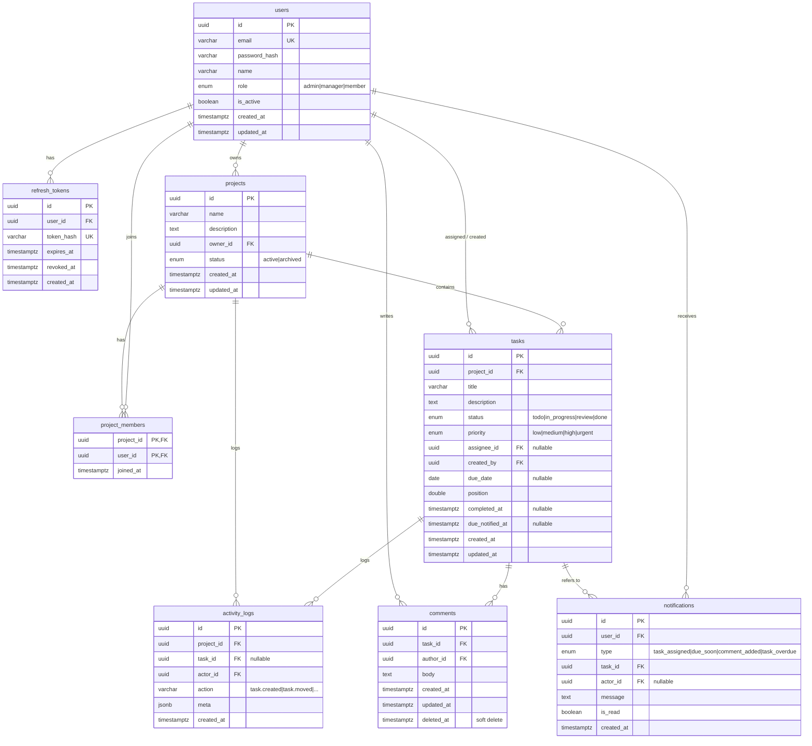

# 원격 팀 프로젝트 관리 웹앱 — 설계 문서

> 대상: 2~10명 규모의 소규모 원격 팀
> 스택: React(Vite) · Node.js + Express · **Supabase(관리형 PostgreSQL)** · Socket.io · JWT
> 배포: **Vercel(프론트 + Express 함수, 단일 프로젝트·동일 오리진) + Supabase**, Socket.io 다중 인스턴스용 Redis(Vercel Marketplace)
> 상태: 구현 완료(M0~M9). 구현 중 확정한 규칙은 각 절의 "구현 규칙" 인용문에 적었다. 보안 점검 결과는 [SECURITY.md](SECURITY.md), 배포·운영은 [DEPLOYMENT.md](DEPLOYMENT.md).

---

## 0. 설계 원칙 및 주요 결정

| 결정 | 선택 | 이유 |
|---|---|---|
| 권한 모델 | **시스템 역할(users.role)** 하나 + 프로젝트 멤버십 | 팀이 작아 단순함이 우선. Admin=전체, **프로젝트를 만든 사람=그 프로젝트의 소유자(관리자)**, Member/Manager=소속 프로젝트 내 작업. 공개 가입을 열어 두므로 누구나 프로젝트를 만들 수 있다 |
| 프로젝트 접근 | `project_members` 에 속한 사용자만 접근 (Admin 제외) | 프로젝트별 가시성 제어 |
| 칸반 순서 | `position` (double precision, 사이에 끼우는 방식) | 드래그 시 한 행만 UPDATE. 정밀도 고갈 시 재정렬 |
| 상태 | Enum: `todo`, `in_progress`, `review`, `done` | 칸반 컬럼 고정으로 시작 (커스텀 컬럼은 향후 확장) |
| 인증 | Access JWT(15분, 메모리) + Refresh JWT(7일, httpOnly 쿠키, DB에 해시 저장) | XSS로부터 refresh 보호, 로그아웃/폐기 가능 |
| 실시간 | REST로 변경 → 서버가 Socket.io `project:{id}` 룸에 브로드캐스트 | 단일 쓰기 경로(REST)로 일관성 유지, 소켓은 푸시 전용 |
| 마감 임박 알림 | **Vercel Cron** 이 `/api/cron/*` 를 **하루 1회** 호출해 스캔 (마감일이 오늘·내일인 미완료 작업) | Vercel 함수는 상시 프로세스가 아니라 in-process node-cron 사용 불가. **Hobby 플랜은 Cron이 일 1회만 가능**(매시간 표현식은 배포 실패, 실행 시각 ±59분). 매시간 스캔은 Pro 필요. 엔드포인트는 `CRON_SECRET` 으로 보호. 중복 방지 컬럼 사용 |
| 동시 편집 충돌 | 마지막 쓰기 우선 + `updated_at` 기반 낙관적 체크(선택) | 단순화 |
| DB 호스팅 | **Supabase Postgres** (순수 Postgres로만 사용) | Express 서버가 `pg`로 직접 연결. Supabase Auth/Realtime/PostgREST는 쓰지 않음 → 스택(자체 JWT, Socket.io) 유지 |
| DB 접속 | **Transaction pooler(6543)**, `DATABASE_URL`, `pg` prepared statement 비활성 | Vercel 함수는 인스턴스가 늘고 줄어 연결 수가 불안정하므로 풀러 경유. 풀 크기는 작게(함수 인스턴스당 소수) 설정 |
| RLS | 모든 테이블 `ENABLE ROW LEVEL SECURITY`, 정책 없음 | Supabase는 `public` 스키마를 anon key로 PostgREST에 노출함. RLS를 켜고 정책을 두지 않으면 anon/authenticated 직접 접근이 차단되고, 서버(postgres 역할)는 RLS를 우회해 정상 동작 |
| 서버 수평 확장 | **Socket.io Redis adapter 필수** (Vercel Marketplace Redis) | Vercel은 인스턴스를 임의로 늘리고, 소켓 연결은 한 인스턴스에 고정됨. REST 처리 인스턴스와 소켓 보유 인스턴스가 달라도 브로드캐스트가 닿으려면 Redis 경유 필요. 방/접속자 상태를 메모리에 두지 않음 |
| 소켓 연결 | 클라이언트 `transports: ['websocket']`, 재연결 시 refetch | Socket.io 기본 long-polling은 Vercel에서 동작하지 않음. 함수 최대 실행시간(Hobby 300초)에 연결이 끊기므로 재연결이 정상 흐름 |

### 역할별 권한 매트릭스

| 동작 | Admin | Manager | Member |
|---|:-:|:-:|:-:|
| 사용자 역할 변경/비활성화 | ✅ | ❌ | ❌ |
| 프로젝트 생성 | ✅ | ✅ | ✅ (사용자당 최대 20개, Admin 제외) |
| 프로젝트 수정/삭제/멤버 관리 | ✅ | ✅(본인 소유) | ✅(본인 소유) |
| 작업 생성/수정/삭제 | ✅ | ✅ | 생성·수정 ✅ / 삭제는 본인 생성분만(프로젝트 소유자는 모두) |
| 작업 상태 이동 (칸반) | ✅ | ✅ | ✅ (소속 프로젝트) |
| 댓글 작성 | ✅ | ✅ | ✅ |
| 댓글 수정/삭제 | 수정은 작성자만 / 삭제는 모두 | 삭제는 소속 프로젝트 모두 | 본인 것만(프로젝트 소유자는 삭제 가능) |
| 대시보드 조회 | 전체 | 소속 프로젝트 | 소속 프로젝트 |

> 회원가입: 첫 가입자는 자동 Admin. 이후 가입자는 Member. 가입은 **누구에게나 열려 있고**(`ALLOW_REGISTRATION=false` 로 닫을 수 있음), 가입자는 자기 프로젝트를 만들고 이메일로 팀원을 초대해 쓴다. 사용자 목록은 공개하지 않는다(Admin/Manager 만). Admin이 역할 승격.
>
> 사용량 상한(공개 가입 + 무료 DB 용량 보호, 초과 시 409 `LIMIT_REACHED`, 환경변수로 조정): 사용자당 프로젝트 20개(`MAX_PROJECTS_PER_USER`, Admin 제외), 프로젝트당 멤버 50명(`MAX_MEMBERS_PER_PROJECT`), 프로젝트당 작업 1000개(`MAX_TASKS_PER_PROJECT`). 동시 요청에서는 상한을 한두 건 넘을 수 있다(엄격한 잠금은 두지 않음).

---

## 1. ERD

### 1.1 다이어그램



### 1.2 테이블 상세 / 제약 / 인덱스

**users**
- `email` UNIQUE (lower-case 저장), `password_hash` = bcrypt(cost 12)
- 비활성 사용자는 로그인 불가, 기존 작업의 `assignee_id` 는 유지

**refresh_tokens**
- 토큰 원문 대신 SHA-256 해시 저장. 회전(rotation): 재발급 시 기존 토큰 `revoked_at` 설정
- 인덱스: `(user_id)`, `(expires_at)`

**projects**
- `owner_id` → users, ON DELETE RESTRICT
- 삭제는 기본 archive 처리, 하드 삭제는 Admin만(CASCADE로 tasks/comments 삭제)

**project_members**
- PK `(project_id, user_id)`, 양쪽 FK ON DELETE CASCADE
- 인덱스: `(user_id)` — "내 프로젝트" 조회용
- 제약: 작업 담당자는 반드시 해당 프로젝트 멤버여야 함 → **애플리케이션 레벨 검증** (복합 FK로도 가능하나 단순화)

**tasks**
- 인덱스:
  - `(project_id, status, position)` — 칸반 보드 조회/정렬
  - `(assignee_id, status)` — 내 작업 조회
  - `(due_date) WHERE status <> 'done'` — 마감 스캔 (partial index)
- `status` 가 `done` 으로 바뀌면 `completed_at = now()`, 다른 상태로 되돌리면 NULL
- `due_notified_at` — 임박 알림 중복 방지. `due_date` 변경 시 NULL로 리셋
- CHECK: `title` 길이 1~200

**comments**
- 인덱스: `(task_id, created_at)`
- 삭제는 soft delete (`deleted_at`), 본문은 응답 시 "삭제된 댓글"로 마스킹

**notifications**
- 인덱스: `(user_id, is_read, created_at DESC)`
- 보관: 90일 이후 정리(cron)

**activity_logs** (선택 기능이지만 MVP에서 단순 기록 권장)
- 칸반 이동, 담당자 변경 등 이력. 대시보드/타임라인 확장 기반
- 인덱스: `(project_id, created_at DESC)`

### 1.3 대시보드 지표 정의

- **진행률** = `done 작업 수 / 전체 작업 수` (프로젝트별, 전체)
- **지연 작업** = `due_date < CURRENT_DATE AND status <> 'done'`
- 추가 제공: 상태별 개수, 담당자별 미완료 수, 이번 주 마감 예정 수
- **구현 정의**: "오늘"은 `APP_TIMEZONE`(기본 Asia/Seoul) 기준. 이번 주 마감 예정 = 오늘 ≤ 마감일 ≤ 그 주 일요일이면서 미완료(오늘이 일요일이면 오늘만). 진행률은 소수 첫째 자리까지(작업이 없으면 0). 지연 목록은 오래된 순 최대 10건이고 `count` 는 전체 수. 담당자별 집계에는 "미배정"(`userId: null`)이 포함되며 동점이면 미배정이 마지막이다. `GET /dashboard`(내 전체 요약)는 **진행 중(active) 프로젝트만** 합산하고(Admin 은 전체, 그 외는 소속 프로젝트) 프로젝트별 진행률·지연 수와 내 미완료 수(`myOpen`)를 함께 준다. 보관된 프로젝트도 프로젝트 대시보드는 볼 수 있다.

---

## 2. API 설계

### 2.1 공통 규약

- Base URL: `/api/v1`
- 인증: `Authorization: Bearer <accessToken>` (인증 필요 엔드포인트 전체)
- 형식: JSON, 날짜는 ISO 8601 (`due_date` 만 `YYYY-MM-DD`)
- ID: UUID
- 에러 포맷:
```json
{ "error": { "code": "VALIDATION_ERROR", "message": "title is required", "details": [{ "field": "title", "issue": "required" }] } }
```
- 상태 코드: 200/201/204, 400(검증), 401(미인증), 403(권한), 404, 409(중복), 429(레이트리밋)
- 페이지네이션(목록): `?page=1&limit=20` → `{ "data": [...], "meta": { "page":1, "limit":20, "total":57 } }`

### 2.2 엔드포인트 목록

#### Auth
| 메서드 | 경로 | 설명 | 권한 |
|---|---|---|---|
| POST | `/auth/register` | 회원가입 | 공개 |
| POST | `/auth/login` | 로그인 | 공개 |
| POST | `/auth/refresh` | 토큰 재발급 (쿠키) | 공개 |
| POST | `/auth/verify-email` | 메일 링크의 토큰으로 이메일 인증 `{ token }` (일회용·24시간) | 공개 |
| POST | `/auth/resend-verification` | 인증 메일 재발송 `{ email }`. 가입 여부와 무관하게 항상 202 | 공개(레이트리밋) |
| POST | `/auth/forgot-password` | 비밀번호 재설정 메일 요청 `{ email }`. 항상 202 | 공개(레이트리밋) |
| POST | `/auth/reset-password` | `{ token, password }` 로 새 비밀번호 설정(일회용·1시간). 기존 세션 모두 폐기 | 공개 |
| POST | `/auth/logout` | 로그아웃(refresh 폐기). 쿠키 기반이라 access 토큰이 만료돼도 가능 | 공개(쿠키) |
| GET | `/auth/me` | 내 정보 | 로그인 |

#### Users
| 메서드 | 경로 | 설명 | 권한 |
|---|---|---|---|
| GET | `/users` | 사용자 목록 (멤버 초대용 검색 `?q=`) | **Admin, Manager** (공개 가입이 열려 있어도 일반 계정이 팀원 이름·이메일을 볼 수 없게 "로그인"에서 변경) |
| PATCH | `/users/:id/role` | 역할 변경 | Admin |
| PATCH | `/users/:id/status` | 활성/비활성 | Admin |
| PATCH | `/users/me` | 내 프로필(이름/비밀번호) 수정 | 본인 |

#### Projects
| 메서드 | 경로 | 설명 | 권한 |
|---|---|---|---|
| GET | `/projects` | 내가 속한 프로젝트 목록 | 로그인 |
| POST | `/projects` | 프로젝트 생성 (생성자가 소유자) | 로그인한 누구나 |
| GET | `/projects/:id` | 상세 | 멤버 |
| PATCH | `/projects/:id` | 수정/아카이브 | Admin, 소유 Manager |
| DELETE | `/projects/:id` | 삭제 | Admin |
| GET | `/projects/:id/members` | 멤버 목록 | 멤버 |
| POST | `/projects/:id/members` | 멤버 추가 | Admin, 소유 Manager |
| DELETE | `/projects/:id/members/:userId` | 멤버 제거 | Admin, 소유 Manager |

> 구현 규칙: 멤버 추가 body 는 `{ userId }` 또는 `{ email }` 중 하나(이메일은 정확히 일치·대소문자 무시, 없으면 404, 활성 사용자만, 이미 멤버면 409 `ALREADY_MEMBER`). 일반 사용자는 사용자 목록을 못 보므로 이메일로 초대한다. 소유자는 제거할 수 없다(409 `OWNER_CANNOT_BE_REMOVED`). 비멤버는 403, 없는 프로젝트는 404. 프로젝트 생성자는 항상 소유자이자 멤버다. 관리 권한(수정·삭제·멤버 관리)은 Admin 과 **프로젝트 소유자**(시스템 역할과 무관)에게 있다. 삭제는 하드 삭제(CASCADE)이며 되돌릴 수 있는 정리는 `status=archived`.

#### Tasks
| 메서드 | 경로 | 설명 | 권한 |
|---|---|---|---|
| GET | `/projects/:id/tasks` | 작업 목록/칸반 데이터 (필터: `status, assignee, priority, due_before, q`) | 멤버 |
| POST | `/projects/:id/tasks` | 작업 생성 | 멤버 |
| GET | `/tasks/:id` | 상세 | 멤버 |
| PATCH | `/tasks/:id` | 필드 수정 (제목, 설명, 담당자, 우선순위, 마감일) | 멤버 |
| PATCH | `/tasks/:id/move` | 칸반 이동 (상태+위치) | 멤버 |
| DELETE | `/tasks/:id` | 삭제 | Admin/Manager/작성자 |
| GET | `/tasks/mine` | 내게 배정된 작업 | 로그인 |

> 구현 규칙(M4 이동): 컬럼으로의 동시 이동은 컬럼(프로젝트+상태) 단위 advisory lock 으로 직렬화한다(빈 컬럼에서는 행 잠금이 동작하지 않아 position 이 중복되는 문제를 실DB 에서 확인). 이웃 간격이 1e-3 미만이면 컬럼을 1024 간격으로 재정렬한 뒤 다시 계산하고, 이웃이 대상 컬럼에 없으면 400, 순서가 뒤집혀 있으면 409 `STALE_POSITION`. 완료 시각은 done 으로 들어올 때만 설정하고 done 안에서의 이동은 유지한다.
>
> 구현 규칙(M3): `PATCH /tasks/:id` 는 `status` 변경도 받는다(해당 컬럼 맨 아래로 이동, `completed_at` 갱신). 위치까지 지정하는 이동은 M4 의 `/move`. 목록 필터 `assignee` 는 `me`·`unassigned`·사용자 ID, `groupBy=status` 면 `{ columns }` 로 응답. 담당자는 활성 프로젝트 멤버여야 하며(신규 지정·변경 시 검사), 멤버가 프로젝트에서 제거되면 그 프로젝트에서 배정된 작업은 미배정이 된다. **보관된 프로젝트의 작업은 읽기 전용**(생성·수정·삭제 시 409 `PROJECT_ARCHIVED`). 삭제는 Admin/Manager 는 모두, Member 는 본인이 만든 작업만. `due_date` 는 `YYYY-MM-DD` 문자열로만 다룬다(시간대로 인한 날짜 밀림 방지). `/tasks/mine` 은 접근 가능한 프로젝트의 작업만 보인다.

#### Comments
| 메서드 | 경로 | 설명 | 권한 |
|---|---|---|---|
| GET | `/tasks/:id/comments` | 댓글 목록 | 멤버 |
| POST | `/tasks/:id/comments` | 댓글 작성 | 멤버 |
| PATCH | `/comments/:id` | 수정 | 작성자 |
| DELETE | `/comments/:id` | 삭제 | 작성자/Admin/Manager |

> 구현 규칙(M6): 권한표의 "댓글 수정: Admin/Manager 모두"와 API 표의 "수정: 작성자"가 달랐고, **수정은 작성자만**으로 확정했다(남의 글을 고치지 않는다). 삭제는 작성자·Admin·Manager(프로젝트 멤버). 삭제는 소프트 삭제이며 응답에서는 `body: "삭제된 댓글"`, `deleted: true` 로 가리고 목록에는 남긴다. 수정된 댓글은 `edited: true`. 댓글은 최대 5000자, 앞뒤 공백 제거, 본문은 문자열로만 저장·렌더링한다(HTML 해석 안 함). 보관된 프로젝트에서는 작성·수정·삭제가 409. 작업 응답에는 삭제되지 않은 댓글 수 `commentCount` 가 포함된다. 변경은 `comment:created/updated/deleted` 로 프로젝트 방에 전달된다.

#### Notifications
| 메서드 | 경로 | 설명 | 권한 |
|---|---|---|---|
| GET | `/notifications` | 목록 (`?unread=true`) | 본인 |
| GET | `/notifications/unread-count` | 안읽은 개수 | 본인 |
| PATCH | `/notifications/:id/read` | 읽음 처리 | 본인 |
| POST | `/notifications/read-all` | 전체 읽음 | 본인 |

#### Dashboard
| 메서드 | 경로 | 설명 | 권한 |
|---|---|---|---|
| GET | `/dashboard` | 내 전체 요약 (소속 프로젝트 합산) | 로그인 |
| GET | `/projects/:id/dashboard` | 프로젝트별 요약 | 멤버 |

### 2.3 요청/응답 예시

**POST `/auth/register`**
```json
// 요청
{ "email": "jiho@example.com", "password": "S3cure!pass", "name": "지호" }
// 201
{ "user": { "id": "u1…", "email": "jiho@example.com", "name": "지호", "role": "member" },
  "accessToken": "eyJ…" }
// + Set-Cookie: refresh_token=…; HttpOnly; Secure; SameSite=Strict; Path=/api/v1/auth
```

> 이메일 인증·재설정(2026-10-15): 메일은 Brevo 무료 플랜(`BREVO_API_KEY`, `MAIL_FROM`)으로 보낸다. **둘 다 설정돼 있을 때만 켜지며**, 켜져 있으면 가입 응답이 `201 { user, needsVerification: true }`(세션·쿠키 없음)이고 인증 전 로그인은 403 `EMAIL_NOT_VERIFIED`(비밀번호가 맞을 때만 알려 줌), refresh 도 거부된다. 꺼져 있으면 기존처럼 가입 즉시 사용하고 재설정 메일은 나가지 않는다. 토큰은 32바이트 난수이고 DB 에는 SHA-256 해시만 저장한다(`email_tokens`, 같은 종류의 새 토큰이 이전 토큰을 무효화, 한 번에 소비). 같은 사용자에게 같은 종류의 메일은 60초에 한 번만 보낸다. 재설정에 성공하면 이메일도 인증된 것으로 보고 모든 refresh 세션을 폐기한다. 링크 주소는 요청 헤더가 아니라 `APP_URL`(없으면 Vercel 운영 도메인)로만 만든다. 예약 도메인(`.test` 등)으로는 보내지 않는다. 마이그레이션 `006_email_tokens` 이전 가입자는 인증된 것으로 취급한다.

**POST `/auth/login`**
```json
// 요청
{ "email": "jiho@example.com", "password": "S3cure!pass" }
// 200
{ "user": { "id": "u1…", "name": "지호", "role": "manager" }, "accessToken": "eyJ…" }
// 401
{ "error": { "code": "INVALID_CREDENTIALS", "message": "이메일 또는 비밀번호가 올바르지 않습니다." } }
```

**POST `/projects`**
```json
// 요청
{ "name": "웹사이트 리뉴얼", "description": "Q4 리뉴얼", "memberIds": ["u2…", "u3…"] }
// 201
{ "id": "p1…", "name": "웹사이트 리뉴얼", "ownerId": "u1…", "status": "active",
  "members": [{ "id": "u1…", "name": "지호" }, { "id": "u2…", "name": "민서" }], "createdAt": "…" }
```

**POST `/projects/:id/tasks`**
```json
// 요청
{ "title": "로그인 화면 디자인", "description": "피그마 시안 반영", "assigneeId": "u2…",
  "priority": "high", "dueDate": "2026-10-20", "status": "todo" }
// 201
{ "id": "t1…", "projectId": "p1…", "title": "로그인 화면 디자인", "status": "todo",
  "priority": "high", "assignee": { "id": "u2…", "name": "민서" }, "dueDate": "2026-10-20",
  "position": 3072.0, "createdBy": "u1…", "createdAt": "…" }
```

**GET `/projects/:id/tasks?assignee=u2…`** (칸반용 그룹 응답, `?groupBy=status`)
```json
{ "columns": {
    "todo":        [{ "id": "t1…", "title": "…", "priority": "high", "assignee": {…}, "dueDate": "…", "position": 1024, "commentCount": 2 }],
    "in_progress": [],
    "review":      [],
    "done":        []
} }
```

**PATCH `/tasks/:id/move`** (드래그 앤 드롭)
```json
// 요청: 대상 컬럼에서 이동 후 바로 위(beforeTaskId)·바로 아래(afterTaskId)에 올 task 를 알려주면 서버가 position 계산
// (둘 다 있으면 중간값, before 만 있으면 맨 아래(before+1024), after 만 있으면 맨 위(after/2), 둘 다 없으면 컬럼 맨 아래)
{ "status": "in_progress", "beforeTaskId": "t7…", "afterTaskId": null }
// 200
{ "id": "t1…", "status": "in_progress", "position": 2048.0, "completedAt": null, "updatedAt": "…" }  // t7 의 position 이 1024 일 때 (실제로는 task 전체 필드를 반환)
// 403 (비멤버)
{ "error": { "code": "FORBIDDEN", "message": "프로젝트 멤버가 아닙니다." } }
```

**POST `/tasks/:id/comments`**
```json
// 요청
{ "body": "시안 v2 올렸어요 @민서" }
// 201
{ "id": "c1…", "taskId": "t1…", "author": { "id": "u1…", "name": "지호" }, "body": "…", "createdAt": "…" }
```

**GET `/notifications?unread=true`**
```json
{ "data": [
  { "id": "n1…", "type": "task_assigned", "taskId": "t1…", "message": "지호님이 '로그인 화면 디자인' 작업을 배정했습니다.", "isRead": false, "createdAt": "…" },
  { "id": "n2…", "type": "due_soon", "taskId": "t4…", "message": "'API 문서화' 마감이 24시간 이내입니다.", "isRead": false, "createdAt": "…" }
], "meta": { "page": 1, "limit": 20, "total": 2 } }
```

**GET `/projects/:id/dashboard`**
```json
{ "projectId": "p1…",
  "progress": { "total": 24, "done": 9, "percent": 37.5 },
  "byStatus": { "todo": 8, "in_progress": 5, "review": 2, "done": 9 },
  "overdue": { "count": 3, "tasks": [{ "id": "t9…", "title": "…", "dueDate": "2026-10-10", "assignee": {…} }] },
  "dueThisWeek": 4,
  "byAssignee": [{ "userId": "u2…", "name": "민서", "open": 6 }] }
```

### 2.4 Socket.io 이벤트 설계

**연결/인증**: `io(url, { auth: { token: accessToken } })` → 서버 미들웨어에서 JWT 검증, 실패 시 연결 거부. 토큰 만료 시 재연결 때 새 토큰 사용.

**룸**
- `user:{userId}` — 개인 알림 (연결 시 자동 join)
- `project:{projectId}` — 프로젝트 보드 (클라이언트가 `project:join` 요청 → 서버가 멤버십 검증 후 join)

| 방향 | 이벤트 | 페이로드 | 설명 |
|---|---|---|---|
| C→S | `project:join` | `{ projectId }` | 보드 진입 시 (ack로 성공/실패) |
| C→S | `project:leave` | `{ projectId }` | 보드 이탈 |
| S→C | `task:created` | `{ task }` | 작업 생성 |
| S→C | `task:updated` | `{ task }` | 필드 수정 |
| S→C | `task:moved` | `{ taskId, status, position, movedBy }` | 칸반 이동 |
| S→C | `task:deleted` | `{ taskId }` | 삭제 |
| S→C | `comment:created` / `comment:updated` / `comment:deleted` | `{ taskId, comment }` | 댓글 변경 |
| S→C | `member:added` / `member:removed` | `{ projectId, user }` | 멤버 변경. 프로젝트 방과 해당 사용자의 개인 방(`user:{id}`)에 모두 전송 |
| S→C | `project:updated` / `project:deleted` | `{ projectId, project? }` | 프로젝트 수정·보관·삭제 (구현에서 추가) |
| S→C | `notification:new` | `{ notification }` | 개인 알림 푸시 |
| S→C | `presence:update` (선택) | `{ projectId, onlineUserIds }` | 접속자 표시 |

**구현 규칙(M5)**
- 소켓 연결은 `auth.token` 에 유효한 access JWT 가 있고 활성 사용자일 때만 허용한다(REST 와 같은 규칙). 연결되면 `user:{id}` 방에 자동 입장한다.
- `project:join` 은 매번 사용자 활성 여부와 멤버십(Admin 은 전체)을 DB 에서 다시 확인하고 ack 로 `{ ok }` 또는 `{ ok:false, error }` 를 돌려준다.
- 변경 요청에 `X-Socket-Id` 헤더를 실으면 그 소켓은 이벤트에서 제외된다. 이벤트는 DB 커밋 이후 REST 핸들러가 발행하며, 발행 실패가 REST 응답을 깨뜨리지 않는다.
- 접근 회수: 멤버가 제거되면 `member:removed` 를 보낸 뒤 해당 사용자의 소켓을 프로젝트 방에서 내보낸다. 사용자를 비활성화하거나 역할을 바꾸면 그 사용자의 소켓 연결을 끊는다(재연결 시 권한 재검증).
- 클라이언트는 이벤트를 받으면 해당 쿼리를 다시 가져오고(invalidate), 연결/재연결 때마다 방에 다시 입장하고 전부 다시 가져와 유실을 보정한다. **서버가 연결을 끊은 경우(`io server disconnect`)에는 socket.io 가 자동 재연결하지 않으므로 클라이언트가 직접 다시 연결한다.** 2초 넘게 끊기면 안내를 띄운다. Redis 어댑터 연결이 실패하면 단일 인스턴스 모드로 계속 동작한다.

**동기화 원칙**
1. 변경은 **REST로만** 수행 → 서버가 DB 커밋 후 `io.to('project:ID').emit(...)` (요청자 소켓 제외 가능: `X-Socket-Id` 헤더)
2. 클라이언트는 낙관적 UI 업데이트 → 실패 시 롤백
3. 재연결 시 해당 프로젝트 tasks를 다시 fetch (이벤트 유실 보정)

### 2.5 알림 생성 규칙

| 트리거 | 수신자 | 타입 |
|---|---|---|
| 작업 생성/수정으로 담당자 지정·변경 | 새 담당자 (본인이 본인에게 지정 시 제외) | `task_assigned` |
| 마감일이 오늘·내일 & 미완료 (cron, 매일 1회) | 담당자 | `due_soon` (`due_notified_at` 로 1회만) |
| 마감 경과 & 미완료 (cron, 매일 오전) | 담당자 | `task_overdue` |
| 내 담당 작업에 댓글 | 담당자·작성자 (댓글 작성자 제외) | `comment_added` |

> 구현 규칙(M7): 알림은 부가 기능이라 생성에 실패해도 원래 요청을 깨뜨리지 않는다. 수신자는 활성 사용자이면서 해당 프로젝트 멤버여야 한다. 생성 즉시 `notification:new` 를 수신자의 개인 방(`user:{id}`)으로 푸시한다. 마감 알림은 `GET /api/cron/daily`(Vercel Cron, 하루 1회, `Authorization: Bearer CRON_SECRET`) 가 만든다 — 마감일이 오늘·내일인 미완료 작업은 `due_soon`, 오늘 이전은 `task_overdue`. 각각 `due_notified_at` / `overdue_notified_at` 으로 한 번만 알리고(대상 확보와 알림 생성은 한 트랜잭션), 마감일이 바뀌면 둘 다 초기화한다. 완료·담당자 없음·보관된 프로젝트·비활성/제거된 담당자의 작업은 제외한다. "오늘"은 `APP_TIMEZONE`(기본 Asia/Seoul) 기준이다. 같은 Cron 이 90일 지난 알림과 만료된 refresh 토큰을 정리한다. 클라이언트는 알림을 누르면 `/projects/:id?task=:taskId` 로 이동해 해당 작업을 연다.

---

## 3. 폴더 구조

모노레포(npm workspaces) — 클라이언트/서버 분리, 공유 타입은 1차에서는 생략(필요 시 `packages/shared`).

```
team-pm-app/
├─ docs/
│  └─ DESIGN.md
├─ package.json                 # workspaces: ["client", "server"]
├─ vercel.json                  # 빌드/라우팅(/api → Express 함수), crons
├─ .env.example
├─ .gitignore
├─ README.md
│
├─ server/
│  ├─ package.json
│  ├─ .env.example
│  ├─ db/
│  │  ├─ migrations/            # 001_init.sql … (node-pg-migrate. 마지막에 RLS 활성화 포함, Supabase 프로젝트에 적용)
│  │  └─ seeds/                 # 개발용 샘플 데이터
│  └─ src/
│     ├─ index.js               # http 서버 + socket 부착, 부팅
│     ├─ app.js                 # express 앱 (미들웨어, 라우터 마운트)
│     ├─ config/
│     │  ├─ env.js              # 환경변수 검증
│     │  └─ db.js               # pg Pool
│     ├─ middleware/
│     │  ├─ auth.js             # JWT 검증 → req.user
│     │  ├─ requireRole.js
│     │  ├─ requireProjectMember.js
│     │  ├─ validate.js         # zod 스키마 검증
│     │  ├─ rateLimit.js
│     │  └─ errorHandler.js
│     ├─ modules/               # 도메인별 (routes → controller → service → repository)
│     │  ├─ auth/
│     │  ├─ users/
│     │  ├─ projects/
│     │  ├─ tasks/
│     │  ├─ comments/
│     │  ├─ notifications/
│     │  └─ dashboard/
│     ├─ sockets/
│     │  ├─ index.js            # io 초기화, 인증 미들웨어
│     │  ├─ rooms.js            # join/leave + 멤버십 검증
│     │  └─ emitter.js          # service에서 호출하는 emit 헬퍼
│     ├─ jobs/
│     │  ├─ routes.js           # /api/cron/* 핸들러 (CRON_SECRET 검증)
│     │  └─ dueDateNotifier.js
│     └─ utils/                 # jwt, hash, position 계산, 에러 클래스
│     └─ tests/                 # 통합 테스트 (vitest/jest + supertest)
│
└─ client/
   ├─ package.json
   ├─ vite.config.js            # /api, /socket.io 프록시
   ├─ index.html
   └─ src/
      ├─ main.jsx
      ├─ App.jsx                # 라우터
      ├─ api/                   # axios 인스턴스(토큰 첨부·401 시 refresh), 리소스별 함수
      ├─ socket/                # socket 클라이언트, 이벤트 → 쿼리 캐시 반영
      ├─ context/ (또는 store/) # AuthContext, 필요 시 zustand
      ├─ hooks/                 # useTasks, useProject, useNotifications …
      ├─ routes/                # ProtectedRoute, RoleRoute
      ├─ pages/
      │  ├─ LoginPage / RegisterPage
      │  ├─ DashboardPage
      │  ├─ ProjectListPage
      │  ├─ ProjectBoardPage    # 칸반
      │  ├─ MyTasksPage
      │  └─ AdminUsersPage
      ├─ components/
      │  ├─ board/              # Board, Column, TaskCard (@dnd-kit)
      │  ├─ task/               # TaskModal, TaskForm, CommentList
      │  ├─ notifications/      # Bell, Dropdown
      │  ├─ dashboard/          # ProgressCard, OverdueList
      │  └─ common/             # Button, Modal, Avatar, Toast …
      └─ styles/
```

**주요 라이브러리 제안**
- 서버: `express`, `pg`, `socket.io`, `jsonwebtoken`, `bcrypt`, `zod`, `helmet`, `cors`, `cookie-parser`, `express-rate-limit`, `@socket.io/redis-adapter` + Redis 클라이언트(`redis`), `node-pg-migrate`, `pino`
- 클라이언트: `react-router`, `@tanstack/react-query`, `axios`, `socket.io-client`, `@dnd-kit/core`+`sortable`, `react-hook-form`+`zod`, (스타일) Tailwind CSS
- 테스트: `vitest`, `supertest`, (선택) Playwright E2E

---

## 4. 구현 순서 (마일스톤)

전체를 3단계(1차 중간점검 → 2차 중간점검 → 최종본)로 나눈다. **배포는 마지막이 아니라 단계마다 수행**하며, 각 점검은 로컬이 아닌 **배포본**으로 확인한다. (배포는 Vercel 단일 프로젝트: 프론트 정적 + Express를 `/api` 함수로, 같은 오리진. Socket.io는 Vercel 함수의 WebSocket + Redis adapter, cron은 Vercel Cron. 자세한 내용은 `DEPLOYMENT.md`.)

### 1차 중간점검 (약 8~9일) — 인증 · 프로젝트 · 작업 CRUD, 배포 완료

| M | 목표 | 주요 작업 | 완료 기준 |
|---|---|---|---|
| **M0** (0.5~1일) | 기반 세팅 | 모노레포, env 검증, eslint/prettier, 마이그레이션 도구, `/health`, Socket.io 스파이크 코드, Vercel 진입점·설정 | 로컬에서 client·server 기동, lint·테스트·빌드 통과 |
| **M1** (2~3일) | 인증·사용자 | users/refresh_tokens 마이그레이션, 가입·로그인·refresh·logout·me, 역할 미들웨어, 클라 로그인/가입 화면, ProtectedRoute, axios 인터셉터 | 새로고침 후 세션 유지, 역할별 라우트 차단. **배포본에서 쿠키 동작 확인** |
| **M1.5** (0.5~1일) | **첫 배포 + 스파이크** | **Supabase 프로젝트 생성(dev/prod 분리) 및 `DATABASE_URL` 연결**, Vercel 프로젝트 연결, Redis(Marketplace) 연결, 환경변수 등록, 배포, **WebSocket 스파이크**(Express+Socket.io+Redis adapter로 두 클라이언트 간 메시지 전달을 배포본에서 검증), Vercel Cron(Hobby 일 1회 제한 확인됨)·Redis 무료 한도 확인 | **배포 URL의 `/health`가 DB 연결과 함께 응답**, 로그인·새로고침 쿠키 동작, 스파이크 통과(실패 시 §0 실시간 방식 재검토) |
| **M2** (2일) | 프로젝트·멤버 | projects/project_members CRUD, requireProjectMember, 프로젝트 목록/생성 UI, 멤버 관리 UI, Admin 사용자 관리 | Manager가 프로젝트 생성 후 멤버 초대, 비멤버 접근 403 |
| **M3** (3일) | 작업 CRUD | tasks 마이그레이션/인덱스, 작업 CRUD API, 필터, 작업 모달(담당자·우선순위·마감일), 리스트 뷰 | 작업 생성·수정·삭제·필터 동작 |
| **M3.5** (0.5일) | **1차 배포·스모크 테스트** | 최종 배포, 가입→로그인→프로젝트→작업 흐름 점검, 403 확인 | 배포 URL에서 전체 흐름 통과 → **1차 점검** |

### 2차 중간점검 (약 5~7일) — 칸반 · 실시간 · 댓글 (MVP 완성)

| M | 목표 | 주요 작업 | 완료 기준 |
|---|---|---|---|
| **M4** (2~3일) | 칸반 보드 | `/move` API + position 계산(+재정렬), @dnd-kit 보드, 낙관적 업데이트/롤백 | 컬럼 간·내 드래그 시 순서가 새로고침 후에도 유지 |
| **M5** (2일) | 실시간 동기화 | Socket.io 서버(JWT 인증, 룸, Redis adapter), emitter 연동, 클라 이벤트→쿼리 캐시 반영, websocket 전송 고정, 재연결(백오프)·재조회 | 두 브라우저에서 한쪽 이동이 1초 내 반대쪽 반영. **배포본에서 WebSocket 동작 확인** |
| **M6** (1~2일) | 댓글 | comments API, 작업 모달 댓글 UI, 댓글 실시간 이벤트, 댓글 수 배지 | 댓글 작성/수정/삭제가 양쪽에 즉시 반영 |
| **M6.5** (0.5일) | **2차 배포·스모크 테스트** | 재배포, 2인 동시 접속 시나리오 점검 | MVP 전체가 배포본에서 동작 → **2차 점검** |

### 최종본 (약 5~8일) — 알림 · 대시보드 · 마무리

| M | 목표 | 주요 작업 | 완료 기준 |
|---|---|---|---|
| **M7** (2~3일) | 알림 | notifications API, 할당·댓글 트리거, `notification:new` 푸시, 벨 UI+읽음 처리, Vercel Cron(마감 임박/지연) | 할당 즉시 알림, 마감 임박(하루 전 스캔) 1회 알림 |
| **M8** (1~2일) | 대시보드 | 집계 쿼리(진행률, 지연, 상태별, 담당자별), 대시보드 UI(카드·차트) | 수치가 실제 데이터와 일치 |
| **M9** (2~3일) | 마무리·검증 | 입력 검증 보강, 레이트리밋/helmet/CORS, 에러·빈 상태 UI, 반응형, 통합/E2E 테스트, Supabase 백업(PITR 여부는 요금제 확인)·로그 | 핵심 플로우 E2E 통과 |
| **M9.5** (0.5일) | **최종 배포** | 프로덕션 환경변수·HTTPS 점검, 최종 스모크 테스트 | 프로덕션 확정 → **최종본** |

> 총 예상: 약 3~4주(1인 기준). **M1~M5가 MVP 핵심**이며, M6~M8은 독립적이라 순서 교체 가능(단, 단계 경계를 넘으면 점검 범위가 달라짐).
>
> **배포 시 유의**: 프론트와 API를 하나의 Vercel 프로젝트(동일 오리진)로 배포하므로 `SameSite=Strict` refresh 쿠키 문제가 생기지 않는다. 대신 함수는 상시 프로세스가 아니므로 메모리 상태(소켓 룸, 캐시, 스케줄러)에 의존하지 않는다.

---

## 5. 보안 / 품질 체크리스트

- 비밀번호 bcrypt, 최소 8자; 로그인 레이트리밋(IP+이메일)
- **Supabase**: anon/service_role 키를 클라이언트에 절대 노출하지 않음(클라이언트는 Supabase에 직접 접속하지 않음), `DATABASE_URL` 은 서버 환경변수로만 관리, 전 테이블 RLS 활성화, DB 비밀번호 로테이션 가능하도록 분리
- 모든 입력 zod 검증, SQL은 파라미터 바인딩만 사용
- refresh 토큰 httpOnly 쿠키 + CSRF 완화(SameSite=Strict, refresh 엔드포인트 한정 Path)
- 모든 task/comment 접근 시 **프로젝트 멤버십 검증** (ID 추측 공격 방지 — 404로 응답 고려)
- 소켓 룸 입장 시에도 동일한 멤버십 검증
- 댓글 본문 렌더링은 텍스트로 처리(XSS), 마크다운 도입 시 sanitize
- 환경별 CORS 화이트리스트, `helmet` 적용

## 6. 향후 확장 (범위 외)

초대 링크, 이메일 알림, 파일 첨부, 서브태스크/라벨, 커스텀 칸반 컬럼, @멘션 알림, 작업 검색 전문 인덱스, 감사 로그 UI, Redis adapter(다중 인스턴스), 다국어(i18n)

## 7. 확인이 필요한 열린 질문

1. 첫 가입자 자동 Admin 방식으로 괜찮은지, 아니면 초대 전용으로 할지
2. 한 사용자가 여러 팀(워크스페이스)에 속할 필요가 있는지 (현재는 단일 팀 가정)
3. 이메일 알림이 필요한지 (현재는 앱 내 알림만)
4. 칸반 컬럼을 4개로 고정해도 되는지
5. ~~배포 대상~~ → **결정: Vercel(프론트+Express 함수) + Supabase.** 소켓은 Redis adapter, cron은 Vercel Cron. 스파이크(M1.5) 실패 시 Express만 별도 상시 서버(Render 등)로 분리하는 안으로 되돌린다
6. Supabase를 DB로만 쓸지, 추후 Supabase Auth/Realtime으로 대체할 여지를 둘지 (현재 설계는 DB 전용)
